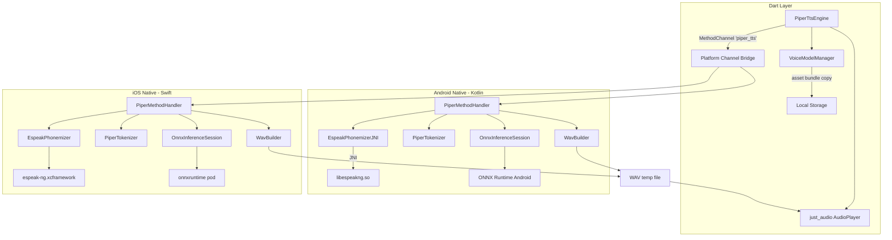

# Design Document: Native Piper TTS

## Overview

This design replaces the current placeholder `PiperTtsEngine` (which shells out to a `piper` binary via `Process.start`) with a fully native, on-device implementation using Flutter platform channels. The native side (Kotlin on Android, Swift on iOS) runs the complete Piper TTS pipeline: text → eSpeak-ng phonemization → token ID mapping → ONNX Runtime inference → float-to-PCM16 conversion → WAV file → playback via `just_audio`.

The Dart-side `PiperTtsEngine` class is rewritten to communicate over a `MethodChannel('piper_tts')` instead of spawning processes. The existing `TtsEngine` interface, `TtsManager`, `TtsSettingsSheet`, and `ChatProvider` remain unchanged — only the internal implementation of `PiperTtsEngine` changes.

Voice models (~60MB `.onnx` + `.onnx.json` pairs) are bundled as Flutter assets and copied to local storage on first launch. The architecture supports adding models at runtime.

## Architecture



### Key Design Decisions

1. **Platform channels over FFI**: We use `MethodChannel` rather than `dart:ffi` because eSpeak-ng and ONNX Runtime have complex C/C++ APIs with lifecycle management. Platform channels let us use Kotlin/Swift wrappers that handle memory, threading, and error propagation naturally. The overhead of a single method call per synthesis is negligible compared to inference time.

2. **Synchronous native pipeline**: The entire synthesis pipeline (phonemize → tokenize → infer → WAV) runs synchronously on the native side in a single `synthesize` call. This avoids multiple round-trips across the platform channel boundary. The Dart side calls `synthesize` on a background isolate-compatible channel, and the native side can use coroutines (Kotlin) or async dispatch (Swift) internally.

3. **WAV file as interchange format**: Rather than streaming raw PCM bytes across the platform channel, we write a WAV file to temp storage and return the path. This is simpler, avoids large byte array serialization overhead, and `just_audio` already supports file playback.

4. **Asset bundling with lazy copy**: Voice models are bundled as Flutter assets (included in the APK/IPA) and copied to local storage on first use. This avoids runtime downloads while allowing the native side to read models from a stable filesystem path (ONNX Runtime needs a file path, not an asset stream).

5. **Android-first, iOS follows same pattern**: Both platforms implement the identical method channel contract. iOS uses the same pipeline with Swift equivalents (onnxruntime-objc pod, espeak-ng xcframework).

## Components and Interfaces

### Dart Side

#### PiperTtsEngine (rewritten)

```dart
class PiperTtsEngine extends TtsEngine {
  static const _channel = MethodChannel('piper_tts');
  final AudioPlayer _player = AudioPlayer();
  bool _isSpeaking = false;
  bool _nativeAvailable = false;
  PiperVoice? _currentVoice;
  List<PiperVoice> _availableVoices = [];

  Future<void> initialize() async;    // checks isAvailable, scans/copies models
  Future<bool> get isAvailable;       // returns _nativeAvailable && voices.isNotEmpty
  Future<void> speak(String text);    // synthesize via channel, play WAV
  Future<void> stop();                // stop AudioPlayer
  void setVoice(PiperVoice voice);   // loadModel via channel
  Future<void> refreshVoices();       // re-scan local storage
  void dispose();                     // dispose AudioPlayer
}
```

#### VoiceModelManager (new helper)

```dart
class VoiceModelManager {
  /// Copy bundled assets from assets/piper_voices/ to local storage.
  Future<void> copyBundledModels() async;

  /// Scan local storage piper/voices/ for .onnx + .onnx.json pairs.
  Future<List<PiperVoice>> scanVoices() async;
}
```

### Platform Channel Contract

Channel name: `piper_tts`

| Method | Arguments | Returns | Description |
|---|---|---|---|
| `isAvailable` | none | `bool` | Whether ONNX Runtime and eSpeak-ng are loaded |
| `loadModel` | `{modelPath: String, configPath: String}` | `bool` | Load ONNX session + parse config |
| `synthesize` | `{text: String}` | `String` (WAV path) | Full pipeline: phonemize → tokenize → infer → WAV |

### Android Native (Kotlin)

#### PiperMethodHandler

Registers the `piper_tts` MethodChannel in `MainActivity.configureFlutterEngine()`. Dispatches method calls to the pipeline components.

```kotlin
class PiperMethodHandler(
    private val context: Context,
    flutterEngine: FlutterEngine
) : MethodChannel.MethodCallHandler {
    private val channel = MethodChannel(flutterEngine.dartExecutor.binaryMessenger, "piper_tts")
    private var phonemizer: EspeakPhonemizer? = null
    private var tokenizer: PiperTokenizer? = null
    private var onnxSession: OrtSession? = null
    private var modelConfig: PiperModelConfig? = null

    fun onMethodCall(call: MethodCall, result: MethodChannel.Result)
}
```

#### EspeakPhonemizer

JNI wrapper around eSpeak-ng's C API. Loads `libespeakng.so`, initializes with bundled data files, and exposes a `phonemize(text: String): String` method that returns IPA phonemes.

```kotlin
class EspeakPhonemizer(private val dataPath: String) {
    external fun nativeInit(dataPath: String): Boolean
    external fun nativePhonemize(text: String, voiceId: String): String
    fun phonemize(text: String): String  // calls nativePhonemize with "en-us"
}
```

#### PiperTokenizer

Parses `phoneme_id_map` from the `.onnx.json` config and converts IPA phoneme strings to padded token ID arrays.

```kotlin
class PiperTokenizer(config: PiperModelConfig) {
    private val phonemeIdMap: Map<String, List<Long>>
    private val padId: Long  // the "_" token

    fun tokenize(phonemes: String): LongArray  // with padding between each phoneme
}
```

#### WavBuilder

Converts float audio array to PCM16 WAV bytes.

```kotlin
object WavBuilder {
    fun floatToWav(samples: FloatArray, sampleRate: Int): ByteArray
    fun writeWavFile(samples: FloatArray, sampleRate: Int, outputPath: String)
}
```

### iOS Native (Swift)

Mirrors the Android architecture with Swift equivalents:

- `PiperMethodHandler` — registered in `AppDelegate.swift`
- `EspeakPhonemizer` — wraps espeak-ng C API via bridging header
- `PiperTokenizer` — same logic as Kotlin version
- `WavBuilder` — same logic as Kotlin version
- Uses `onnxruntime-objc` CocoaPod for ONNX inference


## Data Models

### PiperModelConfig

Parsed from the `.onnx.json` file accompanying each voice model.

```kotlin
// Android (Kotlin)
data class PiperModelConfig(
    val phonemeIdMap: Map<String, List<Long>>,  // IPA char → token ID(s)
    val sampleRate: Int,                         // typically 22050
    val noiseScale: Float,                       // default 0.667
    val lengthScale: Float,                      // default 1.0
    val noiseW: Float,                           // default 0.8
    val numSpeakers: Int,                        // 0 for single-speaker models
    val speakerId: Int?                          // optional speaker index
)
```

```swift
// iOS (Swift)
struct PiperModelConfig {
    let phonemeIdMap: [String: [Int64]]
    let sampleRate: Int
    let noiseScale: Float
    let lengthScale: Float
    let noiseW: Float
    let numSpeakers: Int
    let speakerId: Int?
}
```

### PiperVoice (existing Dart model — unchanged)

```dart
class PiperVoice {
  final String id;          // e.g. "en_IN-custom-medium"
  final String label;       // e.g. "Indian English (custom)"
  final String modelPath;   // local filesystem path to .onnx
  final String configPath;  // local filesystem path to .onnx.json
}
```

### ONNX Input Tensors

| Tensor Name | Shape | Type | Description |
|---|---|---|---|
| `input` | `[1, token_count]` | `int64` | Padded token ID sequence |
| `input_lengths` | `[1]` | `int64` | Number of tokens |
| `scales` | `[3]` | `float` | `[noise_scale, length_scale, noise_w]` |

### ONNX Output Tensor

| Tensor Name | Shape | Type | Description |
|---|---|---|---|
| `output` | `[1, 1, sample_count]` | `float` | Raw audio samples in [-1.0, 1.0] range |

### WAV File Format

Standard RIFF WAV header (44 bytes) + PCM16 data:
- Sample rate: from `PiperModelConfig.sampleRate` (typically 22050 Hz)
- Channels: 1 (mono)
- Bits per sample: 16
- Each float sample clamped to [-1.0, 1.0] and scaled by 32767

### Asset Directory Structure

```
assets/
  piper_voices/
    en_IN-custom-medium.onnx        (~60MB)
    en_IN-custom-medium.onnx.json   (~50KB)
```

After first-launch copy to local storage:
```
<app_support>/piper/voices/
    en_IN-custom-medium.onnx
    en_IN-custom-medium.onnx.json
```

### eSpeak-ng Data Files (Android)

```
android/app/src/main/assets/espeak-ng-data/
    en_dict           # English dictionary
    phondata          # phoneme data
    phonindex         # phoneme index
    phontab           # phoneme table
    intonations       # intonation patterns
```

### eSpeak-ng Native Libraries (Android)

```
android/app/src/main/jniLibs/
    arm64-v8a/
        libespeakng.so
        libespeakng_jni.so
    armeabi-v7a/
        libespeakng.so
        libespeakng_jni.so
```

