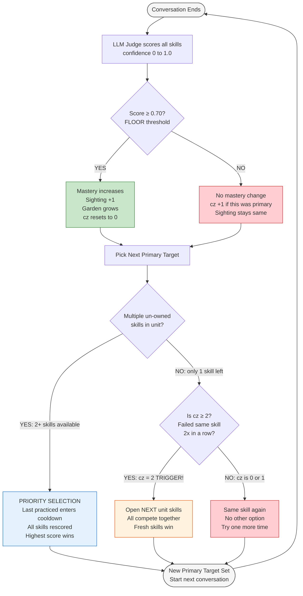
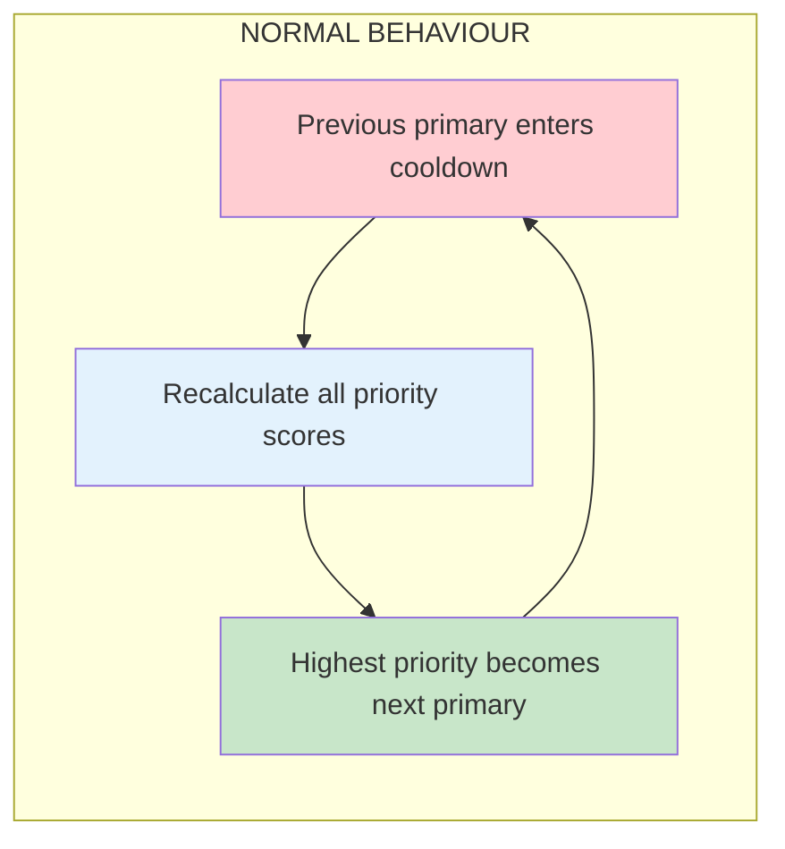
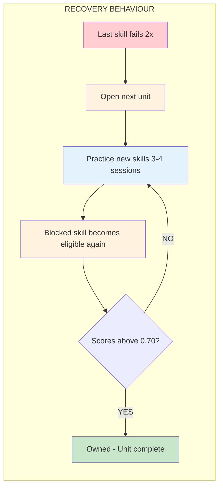

## TL;DR (The Whole System in 6 Lines)

1. **Student talks to Zoe** → LLM judge scores each skill (0.0 to 1.0)
2. **Score ≥ 0.70** → mastery increases, sighting +1, garden grows, consecutive zeros reset
3. **Score < 0.70** → no mastery or sighting update; if the primary skill failed, its consecutive-zero counter increases
4. **Next session** → recency and priority scoring select the next primary skill
5. **If the last remaining skill fails twice** → the next unit opens while the stuck skill waits for another chance
6. **When the stuck skill later scores ≥ 0.70** → it becomes owned, the unit completes, and learning continues normally

<Info>
Each level contains 4–5 units with 3–4 skills each. New units unlock as needed, so a learner is never permanently blocked by a single difficult skill.
</Info>

---

## Adaptive Learning Cycle



### Logic at Each Step

| Flowchart Node | Logic Used | Formula / Rule |
|---|---|---|
| **LLM Judge scores** | DeepSeek evaluates transcript | Confidence = 0.0 to 1.0 per skill |
| **Score ≥ 0.70?** | FLOOR threshold | `FLOOR = 0.70` — below this, evidence is ignored |
| **Mastery ↑** | Bounded learning rate | `new = old + 0.40 × confidence × (1 - old)` |
| **Garden grows** | Sighting incremented | `sightings[skill] += 1` → plant stage changes at 1/2/3 |
| **cz resets** | Consecutive zeros tracker | `consecutive_zeros[skill] = 0` |
| **cz +1** | Consecutive zeros tracker | `consecutive_zeros[skill] += 1` |
| **Multiple skills?** | `active_step()` finds first incomplete unit | Checks how many skills have `bucket != "owned"` |
| **PRIORITY SELECTION** | Priority scoring with cooldown | Score = 0.35×Need + 0.20×Uncertainty + 0.20×ReviewDue + 0.15×Curriculum + 0.10×Variety **- 0.25×Recency** |
| **Recency cooldown** | Recent primary history | `cooldown = recent_count / 4.0` (max 4 tracked) |
| **Is cz ≥ 2?** | Stuck detection | If ALL remaining skills have `consecutive_zeros >= 2` |
| **Open next unit** | `due_unit()` expands pool | Adds next sequential unit's un-owned skills to candidates |
| **Same skill again** | No alternative available | Only 1 skill left + hasn't failed twice yet |
| **New Primary = highest score** | `prioritize_skills()` | All candidates scored → sorted → top one wins |

### The Two Core Behaviours

ELLA's adaptive engine has two core behaviours. Most conversations follow the normal priority-based selection process, where the next skill is chosen dynamically based on its priority score. When progress becomes blocked because only one difficult skill remains, a separate recovery behaviour temporarily expands the learning pool so the learner can continue making progress before revisiting that skill.

| Behaviour | Question it answers |
|---|---|
| **Priority-Based Selection** | "Which skill should we practice next?" |
| **Stuck Skill Recovery** | "What should we do when progress gets blocked?" |

**Priority-Based Selection** — When multiple skills are available:



**Stuck Skill Recovery** — When only 1 skill left and it fails 2x:



| | **Normal Behaviour** | **Recovery Behaviour** |
|---|---|---|
| **When** | Multiple skills are available | One skill remains and it has failed twice |
| **Purpose** | Select the next skill dynamically | Prevent the learner from getting stuck |
| **What happens** | Previous primary cools down → priorities are recalculated → highest priority becomes next primary | Next unit opens → learner practices other skills → blocked skill is retried later |
| **Result** | Different skills are practiced over time | Learning continues without one skill blocking progress |

<Warning>
**Not a fixed rotation.** The order is determined dynamically by priority score. Recently practiced skills get a temporary cooldown, allowing others to become the next primary.
</Warning>

### Session-Based Evaluation

<Note>
ELLA evaluates the entire conversation as a single learning session. Individual turns are not scored independently. After the conversation ends, the LLM Judge assigns one confidence score per skill, updates learner progress, and selects the next primary target for the following conversation.
</Note>


### Candidate Pool Expansion

**Before recovery** (only 1 skill left, no rotation possible):

```text
Candidate Pool:  U1-GRA-01 (only option)
```

**After recovery triggers** (next unit opens, pool expands):

```text
Candidate Pool:  U1-GRA-01  +  U2-VOC-01  +  U2-GRA-01  +  U2-GRA-02  +  U2-FLU-01
```

> Instead of replacing the blocked skill, ELLA expands the candidate pool. The blocked skill remains eligible, but now competes with newly unlocked skills. Priority scoring determines which skill becomes the next primary target. The blocked skill returns naturally as its priority rises after other skills accumulate cooldown.

---

## How It Works (Simple Version)

| What | How |
|---|---|
| **Picking next skill** | Every un-owned skill gets a priority score. The highest score wins. Recently practiced skills get a cooldown, giving other skills a chance. **Order is not linear** — the next skill is determined by priority scores. |
| **When garden grows** | A skill gets a sighting when the student demonstrates it with confidence **≥ 0.70**. |
| **When skill is "owned"** | **Mastery ≥ 0.75** and the skill has been demonstrated in **2+ different topics**. |
| **When unit is "complete"** | All skills in the unit are owned. |
| **When stuck** | The same last un-owned skill gets **2 consecutive sessions with no evidence** → the next unit opens. |
| **Sequencing** | Units always progress **Unit 1 → Unit 2 → Unit 3**. Units are never skipped. |

---
## The Three Systems

| System | Where | What it does |
|---|---|---|
| **Recency** | Within a unit | Recently practiced skill gets a **cooldown**, giving another skill a chance next time. |
| **Consecutive Zeros** | Between units | If the **last remaining un-owned skill** gets 2 consecutive sessions with no evidence, the next unit opens. |
| **Mastery Scoring** | Within a unit | Combines confidence-based evidence over time with **2+ topic contexts** to determine ownership. |

<Note>
**Does the garden still grow?** Yes. Sightings still count toward garden growth, and plants still bloom at 3 sightings. **Garden growth and skill ownership are separate.**
</Note>

---

## Key Definitions

| Term | What it is | How it updates |
|---|---|---|
| **Sighting** | A session where the student demonstrates a skill with confidence **≥ 0.70**. In code, this is `evidence_count`. | +1 after a session where the judge gives confidence ≥ 0.70 |
| **Recency** | A list of the last **4 primary targets**. It is used by the priority formula to give recently practiced skills a cooldown. | After each session, the current primary target is added to the list. Maximum 4 items. |
| **Uncertainty** | "How much data do we have about this skill?" Calculated from sightings: **`1 / √(sightings + 1)`**. Not stored — recalculated when needed. | As sightings increase → uncertainty decreases → the skill becomes less urgent to investigate. |

### Uncertainty formula explained:

The formula is `1 / √(sightings + 1)`. That's it.

- The **1** on top is just the number 1 (constant, never changes)
- The bottom is **sightings + 1** (how many times this skill was demonstrated + 1)

```text
sightings = 0 → 1/√(0+1) = 1/√1 = 1.00  (know nothing, very urgent)
sightings = 1 → 1/√(1+1) = 1/√2 = 0.71  (know a little)
sightings = 3 → 1/√(3+1) = 1/√4 = 0.50  (know enough)
sightings = 8 → 1/√(8+1) = 1/√9 = 0.33  (very sure, low priority)
```

**In plain words:** The more times a skill has been demonstrated, the less urgent it is to test again. Fresh skills (0 sightings) get maximum priority because the system has no data about them.

---

## 1. The Plain-English Version (No Formulas)

Forget the formulas for a moment. Think about **one skill: `VOC-01`**.

### Old system = "Count how many times"

Imagine ELLA is watching whether the student knows `VOC-01`.

The student uses it correctly:

```text
Conversation 1 → ✅ = 1 sighting
Conversation 2 → ✅ = 2 sightings
Conversation 3 → ❌ = still 2
Conversation 4 → ✅ = 3 sightings
```

So the old system basically says:

> **"I saw you do it correctly 3 times, so I'll call this skill Bloomed."**

It doesn't really care *how strong* each performance was after it passes the threshold.

### New system = "How confident am I?"

Now ELLA doesn't just count. It says:

> **"Based on everything I've seen, how confident am I that this student knows VOC-01?"**

It starts at:

```text
0% confidence
```

After the first good demonstration:

```text
32% confidence
```

After another:

```text
54%
```

After another weaker demonstration:

```text
61%
```

After another strong demonstration:

```text
75%
```

And eventually:

```text
82%
```

So instead of:

```text
1 sighting
2 sightings
3 sightings → Bloomed
```

you have:

```text
0%
 ↓
32%
 ↓
54%
 ↓
61%
 ↓
75%
 ↓
82%
```

### And there's one more safety check

Even if ELLA reaches **75% confidence**, it asks:

> "Did I see enough evidence?"

and:

> "Did the student use this skill in different situations?"

So:

```text
75% confidence
+
2+ pieces of evidence
+
2 different contexts
        ↓
      OWNED
```

### The easiest sentence to remember

**Old ELLA:**

> "You did it 3 times → you're good."

**New ELLA:**

> "I've collected enough evidence to become confident that you know it."

That's the fundamental change.

---

## 2. The Core Idea

ELLA does **not** say "Conversation 1 → VOC-01, Conversation 2 → VOC-02…"

After **every** conversation, ELLA recalculates the priority of all eligible skills. The highest-scoring skill becomes the next primary target. The sequence of targets isn't predetermined — it emerges from the student's actual performance.

After every conversation, ELLA asks itself:

1. How confident am I that this student knows each skill?
2. Which skill needs the most attention right now?
3. What haven't I seen this student practice in a while?
4. What was I just focusing on? (Don't repeat it immediately.)

The answers to these questions produce a **priority ranking**, and the highest-priority skill becomes the next conversation target.

---

## 3. Mastery Confidence Score

Every skill has a continuous mastery score represented as a float from `0.0` (locked/unknown) to `1.0` (fully mastered).

### The Update Formula

After a conversation, ELLA's grading engine evaluates the learner's responses. If a learner successfully uses a skill with confidence above the threshold, their mastery score is updated using a bounded learning rate equation:

$$\text{Mastery}_{\text{new}} = \text{Mastery}_{\text{old}} + \eta \cdot \text{Evidence} \cdot (1 - \text{Mastery}_{\text{old}})$$

Where:
* **$\eta$ (Learning Rate):** Set to `0.40`.
* **$\text{Evidence}$:** The qualitative grading confidence returned by the LLM Judge (`0.0` to `1.0`).
* **$(1 - \text{Mastery}_{\text{old}})$:** The learning headroom, ensuring the score asymptotes smoothly towards `1.0`.

### Example: One Skill Over Multiple Conversations

Suppose a skill starts at mastery `0.00` and the student demonstrates it with evidence strength `0.80` each time:

| Conversation | Calculation | Mastery | Status |
|---|---|---|---|
| Start | — | 0.00 | LOCKED |
| C1 | 0 + 0.40 × 0.80 × (1 − 0) | **0.32** | EMERGING |
| C2 | 0.32 + 0.40 × 0.80 × (1 − 0.32) | **0.54** | EMERGING |
| C3 | 0.54 + 0.40 × 0.80 × (1 − 0.54) | **0.69** | EMERGING |
| C4 | 0.69 + 0.40 × 0.80 × (1 − 0.69) | **0.79** | EMERGING* |

*Even at 0.79, the skill is **not automatically OWNED** — see the triple gate below.*

### State Transitions (Buckets)

The continuous score maps directly to the discrete status buckets displayed in the user interface (such as the Conversation Garden):

* **LOCKED:** $\text{Mastery} < 0.25$
* **EMERGING:** $\text{Mastery} \ge 0.25$
* **OWNED (Mastered):** $\text{Mastery} \ge 0.75$ AND $\text{evidence\_count} \ge 2$ AND $\text{context\_diversity} \ge 2$

<Note>
Transitioning to the `owned` state requires **all three conditions**: high mastery confidence, sufficient evidence, AND demonstration across at least 2 distinct conversation topics.
</Note>

---

## 4. Evidence vs Context

These are the two additional gates that prevent premature mastery.

### What is Evidence?

**Evidence = one piece of proof that the student can use the skill.**

For example, suppose VOC-01 is about talking about past activities.

The student says: *"Yesterday I played cricket with my friends."*

ELLA's grader evaluates this and says: `VOC-01 confidence = 0.85`. That is **one piece of evidence**.

Later the student says: *"Last Sunday I visited my grandmother."*

ELLA sees the skill again: `VOC-01 confidence = 0.80`. Now `sightings = 2`.

**Sightings answers: "How many times have I collected meaningful proof?"**

### What is Context?

**Context = the conversation topic in which the student demonstrates the skill.**

| Conversation | Topic | Evidence for VOC-01 |
|---|---|---|
| C1 | Sports | ✅ |
| C2 | Family | ✅ |
| C3 | Travel | ✅ |

Result: `sightings = 3`, `context_diversity = 3`

### Why Context Matters

Imagine a student memorized one sentence: *"Yesterday I played cricket."*

They can say it perfectly every time. But you don't know whether they've actually **learned the underlying skill** or just memorized a phrase.

If they demonstrate the same skill across different topics — sports, family, travel — that's much stronger evidence of genuine, flexible mastery.

### The Critical Distinction

Same topic repeated:

| Conversation | Topic | Evidence | Context |
|---|---|---|---|
| C1 | Sports | ✅ | Sports |
| C2 | Sports | ✅ | Sports |
| C3 | Sports | ✅ | Sports |

Result: `sightings = 3` ✅ but `context_diversity = 1` ❌ → **NOT OWNED**

Different topics:

| Conversation | Topic | Evidence | Context |
|---|---|---|---|
| C1 | Sports | ✅ | Sports |
| C2 | Family | ✅ | Family |
| C3 | Travel | ✅ | Travel |

Result: `sightings = 3` ✅ and `context_diversity = 3` ✅ → **Can be OWNED** (if mastery ≥ 0.75)

<Info>
**In one sentence:** Evidence tells ELLA *"How much proof do I have?"* Context tells ELLA *"How broadly has the student demonstrated it?"*
</Info>

---

## 5. Old System vs New System (Side-by-Side)

Let's take exactly **one skill: `VOC-01`** and run the old vs new system side-by-side using the same learner evidence.

### Assumption

The learner demonstrates `VOC-01` in 5 conversations:

| Conversation | LLM evidence |
|---|---:|
| C1 | 0.80 |
| C2 | 0.80 |
| C3 | 0.40 |
| C4 | 0.90 |
| C5 | 0.70 |

### The Comparison

| Conversation | Evidence | OLD: Sighting system | NEW: Mastery system |
|---|---:|---|---|
| Start | — | 0 sightings → Locked | Mastery = **0.00** |
| C1 | 0.80 | 1st sighting → **Emerging** | 0 + 0.40×0.80×(1−0) = **0.320** |
| C2 | 0.80 | 2nd sighting → **Growing** | 0.320 + 0.40×0.80×(1−0.320) = **0.538** |
| C3 | 0.40 | Doesn't qualify → **still Growing** | 0.538 + 0.40×0.40×(1−0.538) = **0.612** |
| C4 | 0.90 | 3rd sighting → **Bloomed** 🌸 | 0.612 + 0.40×0.90×(1−0.612) = **0.752** |
| C5 | 0.70 | Already Bloomed | 0.752 + 0.40×0.70×(1−0.752) = **0.821** |

### Visual Timeline

```text
OLD
────────────────────────────────────────

C1       C2       C3       C4       C5
│        │        │        │        │
0        1        2        2        3 sightings
         ↓        ↓        ↓
      Emerging  Growing  Bloomed
                           🌸
```

versus:

```text
NEW
────────────────────────────────────────

C1       C2       C3       C4       C5
│        │        │        │        │
0.00 →  0.32 →   0.54 →   0.61 →   0.75 → 0.82
          ↑                  ↑
       Emerging           OWNED*
```

### The Important Correction

At C4, `0.752` is **not automatically OWNED**. The new rule says:

```text
OWNED if:

Mastery ≥ 0.75
AND evidence_count ≥ 2
AND context_diversity ≥ 2
```

So at C4:

```text
Mastery        = 0.752  ✅
Sightings = 4       ✅
Context diversity = ?
```

If the learner used `VOC-01` only in **one context**:

```text
VOC-01
Mastery = 0.752
Evidence = 4
Contexts = 1

→ EMERGING, not OWNED
```

If they used it across **two different contexts**:

```text
VOC-01
Mastery = 0.752
Evidence = 4
Contexts = 2

→ OWNED 🌸
```

### The Strongest Difference

The old system says:

> **"I saw 3 qualifying demonstrations → Bloomed."**

The new system says:

> **"My confidence is 0.752, I've seen enough evidence, and I've seen the learner use it in multiple contexts → Owned."**

So you're no longer saying: **3 times = learned.**

You're saying: **confidence + sufficient evidence + contextual diversity = learned.**

**Key differences:**
- The old system ignores C3 entirely (below threshold). The new system still learns from weak evidence — mastery increases from 0.54 to 0.61.
- The old system declares mastery at C4. The new system waits until context diversity is satisfied.
- The new system never "finishes" — the score continues refining with each new piece of evidence.

---

## 6. Step-by-Step Math Walkthrough

Taking the same `VOC-01` skill, here's each conversation calculated individually:

**Start:** Mastery = 0

### C1 — Evidence = 0.80

```text
0 + 0.40 × 0.80 × (1 - 0)
= 0.32
```

**Mastery = 0.32** → EMERGING

---

### C2 — Evidence = 0.80

```text
0.32 + 0.40 × 0.80 × (1 - 0.32)
= 0.5376
```

**Mastery = 0.538** → EMERGING

---

### C3 — Evidence = 0.40

```text
0.538 + 0.40 × 0.40 × (1 - 0.538)
≈ 0.612
```

**Mastery ≈ 0.612** → EMERGING

---

### C4 — Evidence = 0.90

```text
0.612 + 0.40 × 0.90 × (1 - 0.612)
≈ 0.752
```

**Mastery ≈ 0.752** → Now above the 0.75 threshold!

But you still check:

```text
Mastery >= 0.75       ✅
Sightings >= 2   ✅
Context diversity >= 2 ?
```

If context diversity is only 1: **NOT OWNED YET.**

---

### C5 — Evidence = 0.70

```text
0.752 + 0.40 × 0.70 × (1 - 0.752)
≈ 0.821
```

**Mastery ≈ 0.821** → If context diversity ≥ 2 by now: **OWNED** 🌸

---

## 7. Dynamic Target Selection

Mastery isn't what directly determines the next conversation. ELLA computes a **Priority Score** for each candidate skill:

$$\text{Priority}(s) = 0.35 \cdot \text{Need} + 0.20 \cdot \text{Uncertainty} + 0.20 \cdot \text{ReviewDue} + 0.15 \cdot \text{CurriculumNeed} + 0.10 \cdot \text{Variety} - 0.25 \cdot \text{Fatigue}$$

### Component Weights

| Component | Weight | Calculation | Description |
|---|---|---|---|
| **Need** | `0.35` | $1.0 - \text{Mastery}(s)$ | Prioritizes skills where the learner has the lowest mastery. |
| **Uncertainty** | `0.20` | $\frac{1}{\sqrt{\text{evidence\_count} + 1}}$ | Prioritizes skills with few recorded assessment data points. |
| **Review Due** | `0.20` | $1.0 - e^{-\frac{\text{days\_since\_last\_practice}}{7.0}}$ | Spaced repetition decay. Prioritizes older skills to combat memory decay. |
| **Curriculum Need** | `0.15` | $1.0 - \frac{\text{index}}{\text{total\_skills}}$ | Retains a gentle pull toward the natural curriculum order. |
| **Variety** | `0.10` | $\frac{1}{\text{evidence\_count} + 1.0}$ | Prefers skills that have been practiced less overall. |
| **Recency** | `-0.25` | $\frac{\text{recent\_primary\_count}}{4.0}$ | A **large cooldown** if the skill was a primary target in recent chats. |

### Worked Example: 3 Skills After a Session

Suppose VOC-01 was just the primary target and we now need to pick the next one:

| Skill | Need | Uncertainty | Review | Curriculum | Variety | Recency | **Final Priority** |
|---|---:|---:|---:|---:|---:|---:|---:|
| VOC-01 | 0.25 | 0.25 | 0.40 | 0.80 | 0.25 | 0.75 | **0.22** |
| GRA-01 | 0.70 | 0.50 | 0.80 | 0.90 | 0.50 | 0.00 | **0.66** |
| FLU-01 | 0.50 | 0.33 | 0.30 | 0.60 | 0.33 | 0.00 | **0.43** |

Calculation for GRA-01:

```text
0.35×0.70 + 0.20×0.50 + 0.20×0.80 + 0.15×0.90 + 0.10×0.50 - 0.25×0.00
= 0.245 + 0.10 + 0.16 + 0.135 + 0.05 - 0
= 0.69
```

Therefore:

```text
GRA-01 = 0.66  ← highest priority
```

**Next Primary Target = GRA-01** (not VOC-01, because recency cooldown lowered its priority)

---

## 8. The Recency Cooldown Loop

In a hardcoded model, if a student struggles with a skill, the system keeps serving that same skill as the primary target because they haven't met the "3 sightings" criterion. This creates frustration and engagement blockages.

### How Recency Solves This

```
         Practice VOC-01
                ↓
         Mastery increases slightly
                ↓
         Recency increases (just practiced)
                ↓
   VOC-01 temporarily falls down the priority list
                ↓
   Other skills (GRA-01, FLU-01) get opportunities
                ↓
         Time passes (other conversations happen)
                ↓
      Recency decreases (hasn't been primary recently)
                ↓
    VOC-01 becomes high-priority again
                ↓
         Practice VOC-01 again
```

### 10-Conversation Simulation

With 4 skills (VOC-01, VOC-02, GRA-01, FLU-01), all starting at mastery 0.00:

| Conversation | Primary Target | Why? |
|---|---|---|
| 1 | VOC-01 | Highest initial priority (curriculum order) |
| 2 | GRA-01 | VOC-01 now has recency cooldown, GRA-01 rises |
| 3 | VOC-02 | GRA-01 now has recency cooldown, VOC-02 rises |
| 4 | FLU-01 | VOC-02 now has recency cooldown, FLU-01 rises |
| 5 | VOC-01 | Recency decayed, still has high Need |
| 6 | GRA-01 | Returns for another opportunity |
| 7 | VOC-02 | Returns for another opportunity |
| 8 | VOC-01 | Need remains high, recency decayed again |
| 9 | FLU-01 | Fluency gets another turn |
| 10 | GRA-01 | Grammar gets another turn |

<Warning>
This sequence is **not hardcoded**. The actual result depends on how well the student performs in each conversation. Strong performance raises mastery (reducing Need), which changes the next ranking.
</Warning>

### One Conversation Can Update Many Skills

The primary target guides the conversation topic, but the student's actual speech can provide evidence for **multiple skills simultaneously**.

If the primary target is VOC-01 and the student says:

> *"Yesterday I went to the market with my sister because we needed vegetables."*

ELLA might detect evidence for:
- **VOC-01** (vocabulary about daily activities) ✅
- **GRA-01** (past tense usage) ✅
- **FLU-01** (connected sentence with a reason) ✅

So one conversation can advance multiple skills. This makes the system genuinely non-linear — 10 conversations don't mean 10 skills completed one-by-one.

---

## 9. What Happens After 10 Conversations?

Don't think: *"10 conversations = 10 skills completed."*

Instead, think:

```
10 conversations
       ↓
many pieces of evidence (some skills get evidence in multiple conversations)
       ↓
many mastery scores updated
       ↓
priority scores change continuously
       ↓
primary target keeps shifting based on performance
```

After 10 conversations you might see:

| Skill | Mastery | Status |
|---|---|---|
| VOC-01 | 0.79 | OWNED (practiced in 2+ contexts) |
| VOC-02 | 0.51 | EMERGING |
| GRA-01 | 0.72 | EMERGING |
| FLU-01 | 0.81 | OWNED (practiced in 2+ contexts) |
| VOC-03 | 0.12 | LOCKED |

The next conversation's target is **not** necessarily VOC-02. ELLA recalculates everything fresh and the highest priority wins.

---

## 10. The Big Picture (Old vs New)

```text
OLD SYSTEM                         NEW SYSTEM
────────────────────              ─────────────────────

Evidence                          Evidence
   ↓                                  ↓
Pass threshold?                   LLM confidence score
   ↓                                  ↓
+1 sighting                       Update mastery
   ↓                                  ↓
1 → 2 → 3                         0.32 → 0.54 → 0.61...
   ↓                                  ↓
Bloomed                           Check mastery
                                      +
                                  sightings
                                      +
                                  context diversity
                                      ↓
                                  Calculate priority
                                      ↓
                                  Apply recency
                                      ↓
                                  Select next target
```

<Info>
**The one sentence that explains the change:**

*"The old system counted how many times a learner demonstrated a skill; the new system estimates how confident we are that the learner has mastered it, and then uses that confidence to decide what the learner should practice next."*
</Info>

---

## 11. DB JSON Schema

The adaptive mastery data is saved inside the user's `skills_progress` JSON payload:

```json
{
  "owned": ["A1:U1-VOC-01", "A1:U1-FLU-01"],
  "emerging": ["A1:U1-GRA-01"],
  "mastery": {
    "A1:U1-VOC-01": 0.82,
    "A1:U1-GRA-01": 0.36
  },
  "evidence_count": {
    "A1:U1-VOC-01": 3,
    "A1:U1-GRA-01": 1
  },
  "context_diversity": {
    "A1:U1-VOC-01": ["Shopping and markets", "Celebrations"]
  },
  "recent_primary_history": ["A1:U1-GRA-01"]
}
```


---

## Design Notes & FAQ

<Note>
**Why is rotation non-linear (not VOC-01 → VOC-02 → GRA-01 → FLU-01 in fixed order)?**

Non-linear is intentional. It's what makes this adaptive, not just a rotation playlist. The "randomness" isn't random — it's priority-scored based on the student's actual gaps. If we make it linear, we lose the adaptive part and it's just a round-robin scheduler. The system spends MORE time on what the student needs and LESS time on what they've already got. That's the entire value proposition.
</Note>
