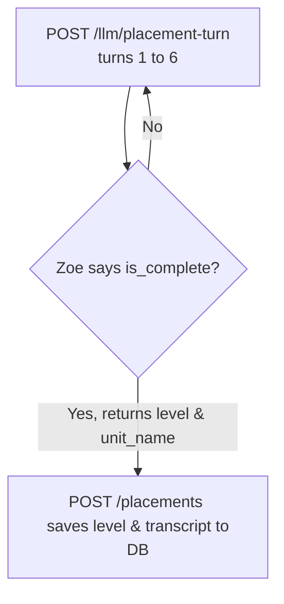

# Loop Simulator — Data Sources

The Loop Simulator at [ella.navgurukul.org/v2/conversation-flow/](https://ella.navgurukul.org/v2/conversation-flow/) is a developer tool for testing the full learning loop. It has several panels on the right side. Here is where each panel gets its data.

## Panel Data Sources

| Panel | Source | Persisted? |
|-------|--------|-----------|
| Memory | `GET /users/me/memory` (backend DB) | Yes |
| API Calls | Browser log of all fetch() calls to the backend | No — lost on refresh |
| Session | Assembled locally from judge response + chat messages | No — lost on refresh |
| Due_next | From `GET /users/me/memory` response | Yes (in DB) |
| Skills | From curriculum_data.py static data (rendered client-side) | Static — never changes |
| History | Accumulated locally across multiple chats in one session | No — lost on refresh |

## What Is Persisted vs Ephemeral

**Persisted in PostgreSQL (survives refresh, device switch, etc.):**
- User profile (name, age, city, level)
- skills_progress (owned, emerging, sightings, strength)
- due_next (what the next session targets)
- persona_memory (facts about the student)
- Messages (every conversation turn)
- Session analyses (judge scores, state changes)

**Ephemeral (browser memory only — lost on page refresh):**
- Session logs in the Session tab
- API call logs in the API Calls tab
- History chart data
- Chat messages displayed on screen (until saved to DB by turn endpoint)

## The Learning Loop (API sequence)

```
1. POST /session         → Start session (auto-picks topic from due_next)
2. POST /session/{id}/turn  → Conversation turns (repeated 5-6 times)
3. POST /llm/judge       → End session + grade skills + update progress
   └─ Updates: skills_progress, due_next, user.level (in DB)
4. GET /users/me/memory  → Read updated state for next session
5. Back to step 1
```

## The Diagnostic Placement Loop (API sequence)

During the Voice Placement screening test, the standard learning loop is bypassed. No active conversation session is created, and `/llm/judge` is not called. Instead, the loop is stateless and adaptive:



1. **`POST /llm/placement-turn`** (Stateless conversation turn — repeated 5-7 times):
   - The app holds the message history locally and submits it on every turn.
   - When the LLM decides the test is complete, the response returns `is_complete: true` along with the graded CEFR level, `unit_name`, evidence highlights, and interests.
   - **Note**: The simulator does **not** call `/llm/judge` during the placement test, preventing `404` errors since there is no database session record.
2. **`POST /placements`** (Save placement results):
   - The client takes the grading payload and posts it to `/placements` to update `user.level` and initialize their syllabus path.


## Session Tab Structure

Each entry in the Session tab is assembled locally after the judge grades a conversation:

```json
{
  "session_id": "s_0001",
  "user_id": "device_uuid",
  "level": "A1",
  "progression_model": "unit",
  "prompt_version": "backend_v1",
  "timestamp": "2026-06-15T14:41:56Z",
  "turns_total": 5,
  "topic": "My name and where I'm from",
  "aimed_at": ["U1-VOC-01", "U1-GRA-01"],
  "hit_targets": ["U1-VOC-01"],
  "skills_evidenced": [
    {
      "id": "U1-VOC-01",
      "name": "I can say my name, age, and where I'm from.",
      "confidence": 0.8,
      "prompted": false,
      "evidence": "I am Ravi. I from India."
    }
  ],
  "state_changes": [
    {
      "id": "U1-VOC-01",
      "from": "emerging",
      "to": "owned"
    }
  ],
  "transcript": [
    {"role": "zoe", "content": "Hi! What's your name?"},
    {"role": "me", "content": "I am Ravi."}
  ]
}
```

This data comes from the `/llm/judge` response combined with the local chat transcript. It is NOT fetched from a separate endpoint.
