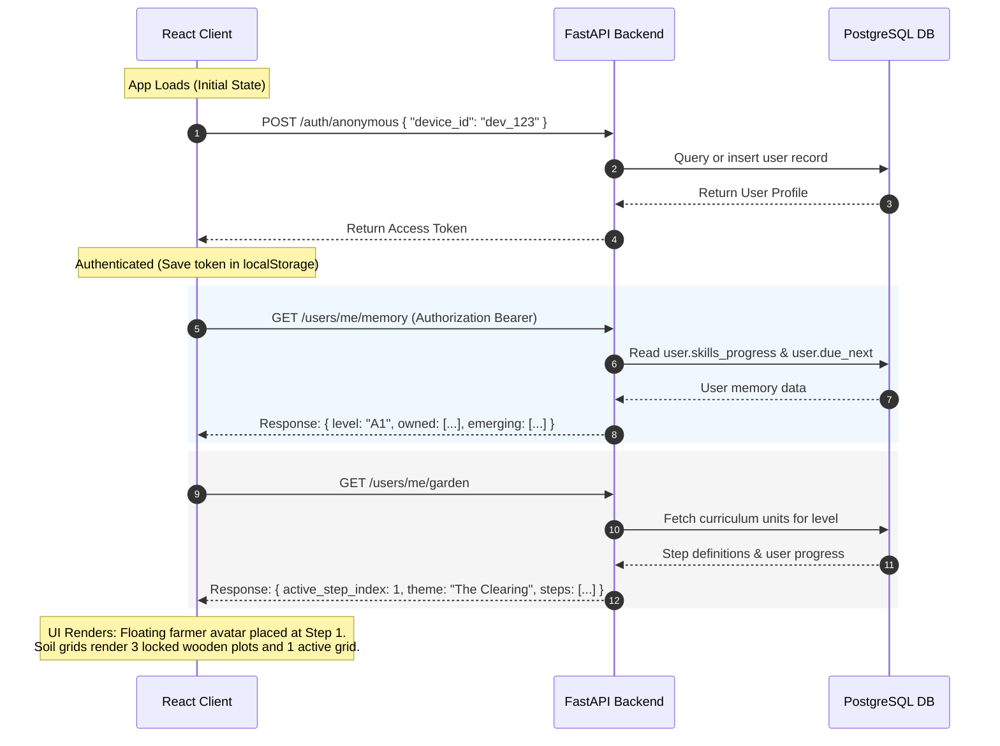
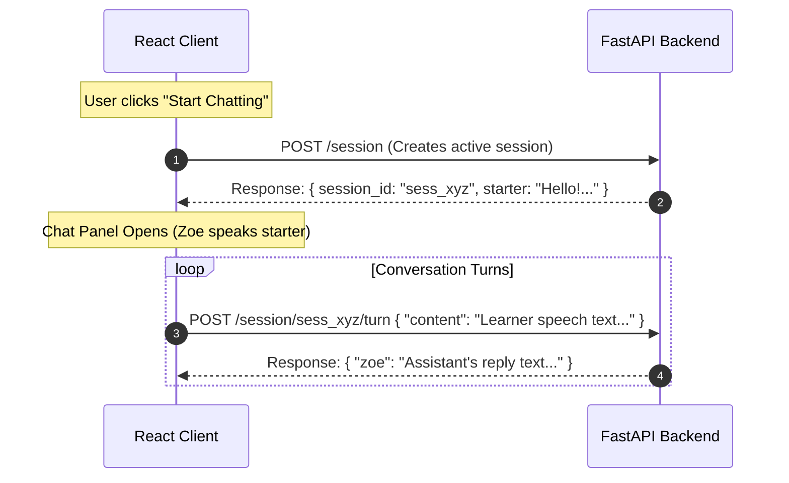
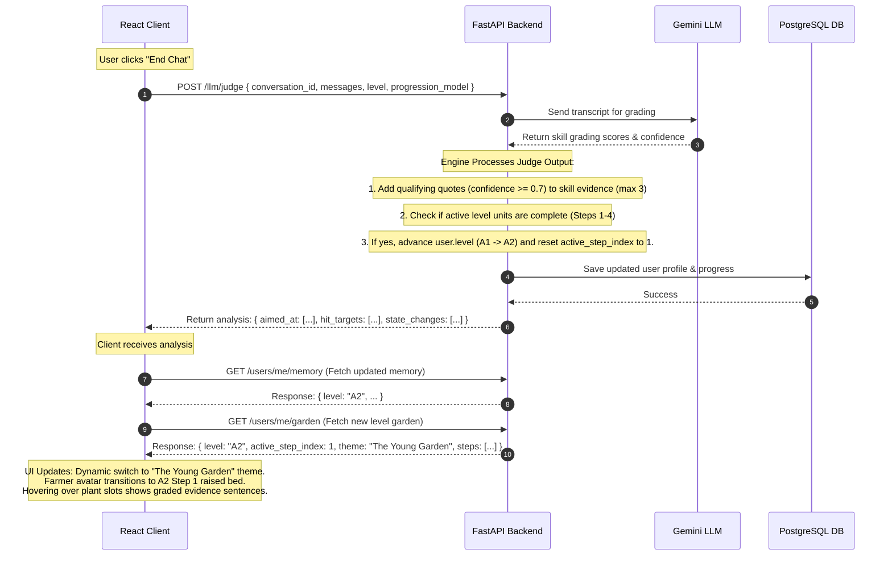

# Garden Progress System

This document outlines the database schema, API responses, backend progression logic, and visual mapping specifications for the level-aware Garden Map progress experience.

---

## 1. Database Architecture (Zero-Migration Schema)

The garden progress system is built on top of the existing SQLite/PostgreSQL `users` table. Instead of creating new database tables, it stores all dynamic checklists, mastery levels, and sightings counts in a single JSON column named `skills_progress`.

### Column Definitions
*   **`level`** (`VARCHAR(5)`): Determines which CEFR syllabus map is loaded (e.g. `'A1'`, `'A2'`).
*   **`skills_progress`** (`JSON`): Stores the user's progress arrays and sighting counts.

### JSON Schema
```json
{
  "owned": [
    "U1-VOC-01",
    "U1-GRA-01"
  ],
  "emerging": [
    "U1-FLU-01",
    "U2-VOC-01"
  ],
  "sightings": {
    "U1-VOC-01": 2,
    "U1-GRA-01": 3,
    "U1-FLU-01": 1
  },
  "strength": {
    "U1-VOC-01": 1,
    "U1-GRA-01": 2
  },
  "last_seen": {
    "U1-VOC-01": "2026-06-24",
    "U1-GRA-01": "2026-06-25"
  },
  "evidence": {
    "U1-VOC-01": [
      "I am happy today.",
      "My mother is a doctor."
    ],
    "U1-GRA-01": [
      "She is running now."
    ]
  },
  "effort": {
    "times_spoken_total": 42
  }
}
```

---

## 2. API Specification (`GET /users/me/garden`)

The mobile client fetches the garden layout via this endpoint. The backend processes the raw database checklists on the fly and returns a pre-computed layout payload.

*   **Method**: `GET`
*   **Route**: `/users/me/garden`
*   **Headers**: `Authorization: Bearer JWT_ACCESS_TOKEN`

### Response Payload
```json
{
  "level": "A1",
  "level_label": "First Words",
  "theme": "The Clearing",
  "active_step_index": 1,
  "recommended_topic": "Today, I wanted to talk about cricket. Shall we?",
  "steps": [
    {
      "step": 1,
      "name": "Describing the world",
      "focus": "Moving from naming things to describing them.",
      "is_completed": false,
      "skills": [
        {
          "id": "U1-VOC-01",
          "strand": "VOC",
          "text": "I can describe what people look like and how they feel using simple adjectives.",
          "status": "owned",
          "sightings": 2,
          "evidence": [
            "I am happy today.",
            "My mother is a doctor."
          ]
        },
        {
          "id": "U1-GRA-01",
          "strand": "GRA",
          "text": "I can use the present continuous to describe what is happening now — She is running.",
          "status": "emerging",
          "sightings": 1,
          "evidence": [
            "She is running now."
          ]
        },
        {
          "id": "U1-FLU-01",
          "strand": "FLU",
          "text": "I can describe a picture or a place using 3–4 connected sentences.",
          "status": "locked",
          "sightings": 0,
          "evidence": []
        }
      ]
    }
  ]
}
```

---

## 3. Pure Backend Progression Logic

The backend calculates all user states and step transitions dynamically using three rules:

### A. Skill Mastery Status
For each skill ID in the active level's curriculum, the backend checks the database arrays:
*   **`"owned"`**: The skill ID exists in `progress["owned"]`.
*   **`"emerging"`**: The skill ID exists in `progress["emerging"]` but not in `owned`.
*   **`"locked"`**: The skill ID is in neither array.

### B. Sightings & Plant Growth Stages
The client maps the number of `sightings` directly to the visual asset of the plant in its grid slot:
*   **0 sightings**: Bare Soil / empty wooden grid.
*   **1 sighting**: Tiny green sprout.
*   **2 sightings**: Leafy stem with closed bud.
*   **3+ sightings**: Tall stem with fully open bloomed flower.

### C. Evidence Storage Rule
For any skill evidenced during chat analysis:
*   **Threshold**: If the match confidence is **`0.7` or above**, the verbatim phrase or sentence spoken by the user is recorded.
*   **Cap**: A maximum of **3 evidence quotes** are stored per skill card (the 3 most recent).
*   **UI Placement**: Evidence appears on the skill details popup/card only after the confidence is met.

### D. Step Completion Rule (The "Grammar Matures Later" Gate)
A step (raised bed) is complete (`is_completed = true`) only when:
1.  All `VOC` (Vocabulary) and `FLU` (Fluency) skills in that step are **`"owned"`** (mastered).
2.  All `GRA` (Grammar) skills in that step are **at least `"emerging"`** (or `"owned"`). 
*(Note: Grammar skills do not block step completion as long as the student has attempted them at least once.)*

### E. Active Step Selection
The client avatar stands at the step matching `active_step_index`.
*   **Algorithm**: The backend loops from Step 1 to Step 4. It returns the step number of the **first incomplete step** (`is_completed == false`).
*   **Fallback**: If all 4 steps are completed, it returns `4` (allowing the avatar to stand at the end of the map).

---

## 4. Visual Mapping Specifications

The front-end client reads the API payload and translates it to visual layout attributes:

*   **Theme Background**:
    *   If `level == "A1"`, load `"The Clearing"` layout (light green meadow theme).
    *   If `level != "A1"`, load `"The Young Garden"` layout (densely forested garden theme).
*   **Alternating Path**:
    *   For step index $i$ ($0$ to $3$):
        *   If $i$ is even $\rightarrow$ Render raised bed on the **left** side of the winding path.
        *   If $i$ is odd $\rightarrow$ Render raised bed on the **right** side of the winding path.
*   **2x2 Slot Layout**:
    *   Map `skills[i]` to `Slot i+1` of the bed's 2x2 grid:
        *   Slot 1: Back-Left
        *   Slot 2: Back-Right
        *   Slot 3: Front-Left
        *   Slot 4: Front-Right
    *   Render the corresponding plant asset based on `sightings` (Empty Soil $\rightarrow$ Sprout $\rightarrow$ Bud $\rightarrow$ Flower).
*   **Strand Colors**:
    *   `VOC` $\rightarrow$ Pink Flower
    *   `GRA` $\rightarrow$ Yellow Flower
    *   `FLU` $\rightarrow$ Purple Flower

### Status UI Translation Rules
*   **`"locked"` Status $\rightarrow$ Slatted Bare Soil Tiles (e.g. Steps 3, 4)**:
    *   *Visual:* The raised bed is rendered as a clean, wooden-slatted flat bed of soil with no plants.
    *   *Logic:* All skills inside these steps have `status == "locked"` and `sightings == 0`.
*   **`"emerging"` Status $\rightarrow$ Buds and Sprouts (e.g. Step 2)**:
    *   *Visual:* The bed contains young plants. Slots display a tiny green sprout (`sightings == 1`) or a green stem topped with a closed, colored bud (`sightings == 2`).
    *   *Logic:* The user is actively practicing these skills in conversation but has not yet reached mastery thresholds.
*   **`"owned"` Status $\rightarrow$ Open Bloomed Flowers (e.g. Step 1)**:
    *   *Visual:* The slots display tall green stems with fully bloomed, open petals colored according to the strand theme.
    *   *Logic:* The user has successfully demonstrated and passed these skills, earning mastery status.

---

## 5. System Architecture & Screen-wise API Flow

This section details the API calls, data payloads, and state updates that occur as a student interacts with the ELLA Loop Simulator. It maps out exactly how the frontend simulator maps to the backend APIs screen-by-screen.

### A. System Architecture Overview

Below is the end-to-end data flow showing how the React frontend, the FastAPI backend, the PostgreSQL Database, and the LLM Judge orchestrate user state, level transitions, and garden progress.

```mermaid
graph TD
    %% Frontend Client
    subgraph Frontend [React Loop Simulator Client]
        UI[User Interface / Garden View / Chat Panel]
        State[Client State: level, activeStepNum, dbGarden, dbMemory]
    end

    %% Backend Services
    subgraph Backend [FastAPI Application Host]
        AuthRouter[/auth/anonymous]
        UsersRouter[/users/me/garden & /users/me/memory]
        SessionRouter[/session & /session/{id}/turn]
        JudgeRouter[/llm/judge]
        Engine[Progression & Curriculum Engine]
    end

    %% Database & LLM
    DB[(PostgreSQL Database)]
    LLM[Google Gemini LLM Service]

    %% Flow Mappings
    UI -->|1. Request Auth/Profile| AuthRouter
    UI -->|2. Fetch Garden/Memory| UsersRouter
    UI -->|3. Start/Run Chat| SessionRouter
    UI -->|4. End Chat & Judge| JudgeRouter

    AuthRouter -->|Query/Create User| DB
    UsersRouter -->|Fetch Progress & Targets| DB
    SessionRouter -->|Fetch/Save Turns| DB
    JudgeRouter -->|Fetch Transcript| DB
    JudgeRouter -->|Grade Transcript| LLM
    JudgeRouter -->|Apply Merges & Level-up| Engine
    Engine -->|Update User Profile & Progress| DB

    DB -.->|Return JSON Data| State
    State -.->|Re-render UI| UI
```

### B. Screen-wise API Flow & State Transitions

#### 1. App Launch & Initialization

When the student opens the application, the client establishes user identity, fetches user history, and builds the visual garden layout.



##### Client State Updates
* **`level`** state is updated to the user's current level (e.g. `"A1"`).
* **`dbMemory`** state is filled with the user's vocabulary and grammar checklists.
* **`dbGarden`** state is updated to populate the 4 steps of the garden (sightings, plant statuses, evidence tooltips).

#### 2. Active Chat Session

When the student clicks "Start Chatting", the client initiates a conversation session based on the active step's target skill.



##### Client State Updates
* **`activeConvId`** is set to the generated `session_id`.
* **`msgs`** array appends messages live as chat balloons appear in the scrollable viewport.

#### 3. Judging, Merging, and Level-up

When the conversation terminates, the backend runs the LLM Judge to check targeted skills, save quote evidence, and progress levels.



##### Client State Updates
* **`backendAnalysis`** is populated to show the graded confidence scores inside the simulator's **Judge** panel.
* **`level`** state updates to `"A2"`, triggering the dropdown to change.
* **`dbGarden`** is updated with the newly retrieved A2 units and reset progress checks.
