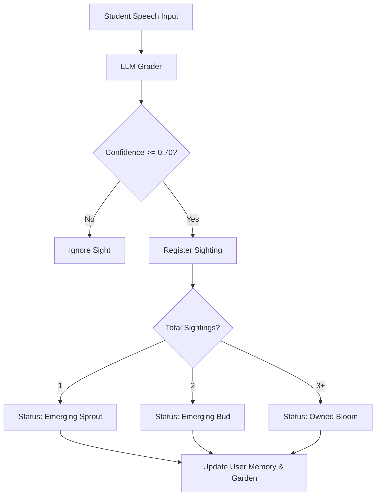

Unlike traditional linear language learning apps that restrict students to lock-step lessons, ELLA allows complete conversation freedom. The student speaks spontaneously on whatever topic they choose, and the backend progression engine identifies skill targets across the entire CEFR grid.

---

## The Non-Linear Pathway

When a student interacts with Zoe:
1. **Passive Tracking:** The engine actively prompts for the student's *primary target* but listens and grades all unowned skills *passively* in the background.
2. **Multi-Unit Activation:** A single spoken turn can evidence vocabulary, grammar, and fluency skills belonging to different units.
3. **Dynamic Promotion:** Plants sprout and bloom inside their respective raised beds regardless of which unit is currently "selected".

---

## Interactive Learning Graph Visualizer

Use the simulator below to select a student spoken input and click **Simulate Speech Turn**. 

Watch how the signal travels from the central level profile node along the links to activate different unit hub beds and update skill nodes non-linearly across the entire level layout. Hover or click on any node to view details and evidence sightings.

<iframe
  src="/logo/learning-graph.html"
  style={{
    width: "100%",
    height: "600px",
    border: "none",
    borderRadius: "12px",
    background: "transparent",
    overflow: "hidden"
  }}
></iframe>

---

## Under the Hood: Progression Merge

When a turn is processed, the parser executes the following evaluation:

This guarantees that a student who spontaneously speaks advanced sentence structures will see their garden bloom advanced plants immediately, without needing to perform linear drills.
