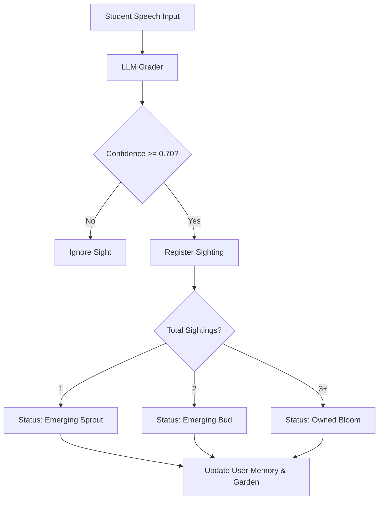
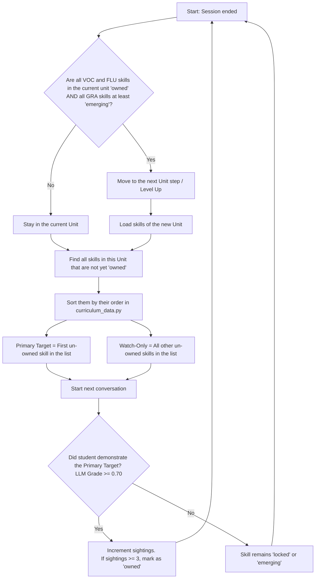

Unlike traditional linear language learning apps that restrict students to lock-step lessons, ELLA allows complete conversation freedom. The student speaks spontaneously on whatever topic they choose, and the backend progression engine identifies skill targets across the entire CEFR grid.

---

## The Non-Linear Pathway

When a student interacts with Zoe:
1. **Passive Tracking:** The engine actively prompts for the student's *primary target* but listens and grades all unowned skills *passively* in the background.
2. **Multi-Unit Activation:** A single spoken turn can evidence vocabulary, grammar, and fluency skills belonging to different units.
3. **Dynamic Promotion:** Plants sprout and bloom inside their respective raised beds regardless of which unit is currently "selected".


---

## Under the Hood: Progression Merge

When a turn is processed, the parser executes the following evaluation:



This guarantees that a student who spontaneously speaks advanced sentence structures will see their garden bloom advanced plants immediately, without needing to perform linear drills.

---

## Unit Completion & Progression Rules

The system uses **different mastery thresholds per strand** to decide when a unit is complete and the student advances to the next one. This is the core of the non-linear design:

| Strand | Required State to Pass | Sightings Needed |
|--------|----------------------|-----------------|
| **VOC** (Vocabulary) | Must be **Owned** | 3/3 |
| **FLU** (Fluency) | Must be **Owned** | 3/3 |
| **GRA** (Grammar) | Must be at least **Emerging** | 1/3 |

### Why Grammar Has a Lower Bar

Grammar is intentionally given a lower threshold because:
- Grammar is **harder to evidence** in natural conversation — students rarely produce textbook-perfect structures spontaneously
- Blocking progression on grammar would frustrate students who communicate effectively despite imperfect grammar
- Grammar skills continue to be **watched and scored** even after the student moves to the next unit — they can still bloom later

### How Unit Progression Works

```python
def unit_complete(progress, unit, level):
    for skill in unit["skills"]:
        status = bucket_of(progress, skill["id"], level)
        # VOC and FLU must be fully mastered
        if skill["strand"] in ("FLU", "VOC") and status != "owned":
            return False
        # GRA only needs to show any evidence (emerging or owned)
        if skill["strand"] == "GRA" and status == "locked":
            return False
    return True
```

### What This Means in Practice

1. Student completes **VOC + FLU** skills (3 sightings each) → unit advances
2. **GRA** skill may still be at emerging (1-2 sightings) → that's OK, student moves forward
3. The GRA skill continues to be **targeted in future sessions** until it reaches owned
4. The garden shows the GRA skill as a growing plant (not yet bloomed) even in a "completed" unit

This ensures students feel progress and momentum while grammar catches up naturally through continued conversation.

---

## Session & Skill Selection Flowchart

The following flowchart describes the decision logic used by the backend progression engine at the end of each session to grade the student and determine the target skills for the next conversation:


