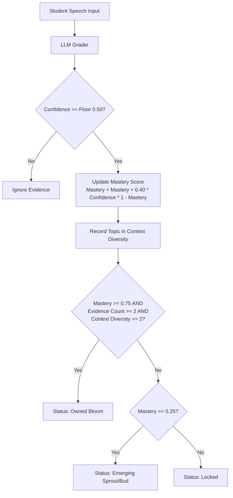
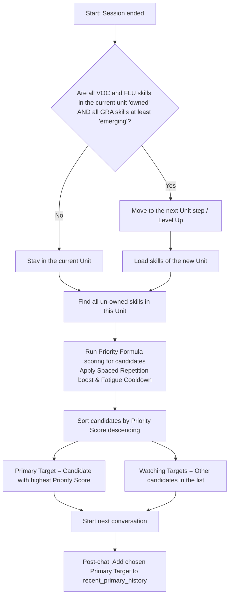

Unlike traditional linear language learning apps that restrict students to lock-step lessons, ELLA allows complete conversation freedom. The student speaks spontaneously on whatever topic they choose, and the backend progression engine identifies skill targets across the entire CEFR grid.

---

## 2D Learning Path Coordinate Grid

Here is a 2D visualization of how skills map to coordinates in the non-linear learning grid:


---

## 1. The Non-Linear Pathway

When a student interacts with Zoe:
1. **Passive Tracking:** The engine actively prompts for the student's *primary target* but listens and grades all unowned skills *passively* in the background.
2. **Multi-Unit Activation:** A single spoken turn can evidence vocabulary, grammar, and fluency skills belonging to different units.
3. **Dynamic Promotion:** Plants sprout and bloom inside their respective raised beds regardless of which unit is currently "selected".

---

## 2. Under the Hood: Progression Merge

When a turn is processed, the parser executes the following evaluation:



This guarantees that a student who spontaneously speaks advanced sentence structures will see their garden bloom advanced plants immediately, without needing to perform linear drills.

---

## 3. Unit Completion & Progression Rules

The system uses **different mastery thresholds per strand** to decide when a unit is complete and the student advances to the next one. This is the core of the non-linear design:

| Strand | Required State to Pass | Mastery / Evidence Needed |
|--------|----------------------|-----------------|
| **VOC** (Vocabulary) | Must be **Owned** | Mastery $\ge 0.75$, Evidence Count $\ge 2$, Context Diversity $\ge 2$ |
| **FLU** (Fluency) | Must be **Owned** | Mastery $\ge 0.75$, Evidence Count $\ge 2$, Context Diversity $\ge 2$ |
| **GRA** (Grammar) | Must be at least **Emerging** | Mastery $\ge 0.25$ |

### Why Grammar Has a Lower Bar
Grammar is intentionally given a lower threshold because:
- Grammar is **harder to evidence** in natural conversation — students rarely produce textbook-perfect structures spontaneously.
- Blocking progression on grammar would frustrate students who communicate effectively despite imperfect grammar.
- Grammar skills continue to be **watched and scored** even after the student moves to the next unit — they can still bloom later.

### How Unit Progression Works
```python
def unit_complete(progress, unit, level):
    for skill in unit["skills"]:
        status = bucket_of(progress, skill["id"], level)
        # VOC and FLU must be fully mastered (owned)
        if skill["strand"] in ("FLU", "VOC") and status != "owned":
            return False
        # GRA only needs to show some evidence (emerging or owned)
        if skill["strand"] == "GRA" and status == "locked":
            return False
    return True
```

---

## 4. Session & Skill Selection Flowchart

The following flowchart describes the decision logic used by the backend progression engine at the end of each session to grade the student, record target fatigue, and rank target skills for the next conversation:



---

## 5. Step-by-Step Selection Logic Breakdown

#### 1. The Gateway Check (Unit Completion)
Right after a conversation session completes:
* **The check:** The engine asks: *"Are all Vocabulary (VOC) and Fluency (FLU) skills in this unit `owned` (mastery $\ge 0.75$, diversity $\ge 2$) AND all Grammar (GRA) skills in this unit at least `emerging` (mastery $\ge 0.25$)?"*
* **Decision:**
  * **Yes:** You advance to the next Unit step (e.g. Unit 1 ➡️ Unit 2). The engine loads the skills of the new unit.
  * **No:** You stay in the current Unit.

#### 2. Picking Targets for the Next Chat (Priority Ranking)
Once the active unit is confirmed:
1. **Find Un-owned Skills:** It takes all the skills in that unit that are not yet `owned`.
2. **Calculate Priority Scores:** For each skill, the system computes a score balancing:
   * **Need:** How far the student is from mastery.
   * **Review Due:** How long it has been since they last practiced it (memory decay).
   * **Curriculum Need:** The natural sequence of the curriculum.
   * **Fatigue Penalty:** A heavy penalty if this skill was a primary target in the last 4 chats.
3. **Primary Target Assignment:** The skill with the **highest priority score** is selected as the **Primary Target** (elicited actively by Zoe).
4. **Watch-Only Targets Assignment:** All other candidate skills are set as **Watch-Only** (Zoe grades them if used naturally).

#### 3. Post-Chat Cooldown Update
At the end of the chat:
* The active primary target is pushed into `recent_primary_history`.
* This ensures that even if a student struggles and fails, that skill gets a fatigue cooldown penalty, letting other skills rotate to the top for the next conversation to avoid frustration.
