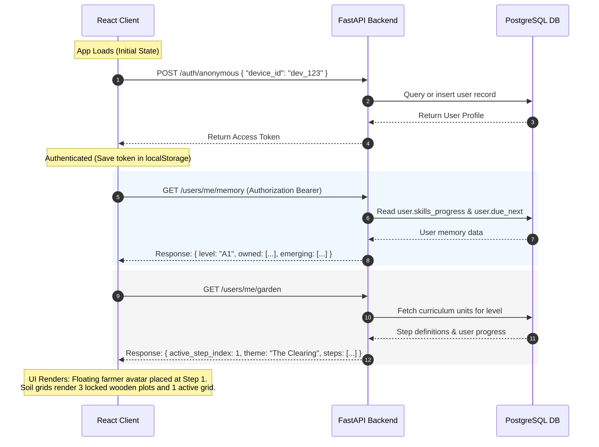
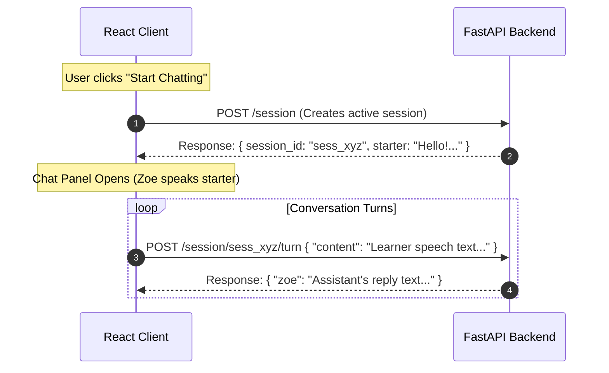
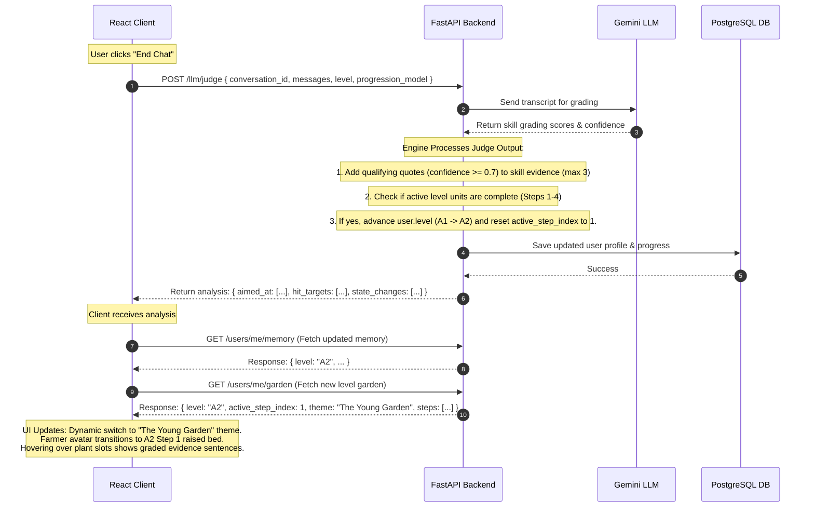

# Ella — Voice-First English Learning App

Ella is a voice-first English learning app for Indian students built by NavGurukul. Students speak to an AI tutor named **Zoe** — no typing required. The app uses on-device speech recognition, AI-powered conversation, and text-to-speech to create a natural, low-pressure speaking practice experience.

**Platform:** Android-first Flutter · **Org:** NavGurukul

---

## What Ella Does

- **Placement test** — Zoe has a short conversation to assess the student's English level (A1–C1)
- **Topic-based conversations** — Students pick a topic (Cricket, Bollywood, School Life, Food, Gaming, Dreams) and have a real conversation with Zoe
- **Free chat** — Open-ended conversation on anything
- **Real-time feedback** — Grammar corrections and vocabulary suggestions woven naturally into the conversation
- **Session summary** — After each session, students see what they did well, new words used, and what to practice next
- **Progress tracking** — Streak, level, and session history

## Who It's For

Indian school students (primarily Hindi-speaking) at A1–B1 English level who need speaking practice but don't have access to English-speaking environments. The app is designed to feel like chatting with a friendly buddy, not a formal test.

## Tech Stack

**Frontend:** Flutter (Android-first) · On-device Whisper STT · Piper TTS · DeepSeek LLM  
**Backend:** FastAPI · PostgreSQL · Docker · AWS EC2

## Design Prototype

All pages live at [ella.navgurukul.org](https://ella.navgurukul.org):

| What | URL | Description |
|------|-----|-------------|
| 📚 **Pedagogy** | [Google Doc](https://docs.google.com/document/d/1Bd4OvFehxRBKiNbFrNwiAeGNUk5Ps7xiysQelWWey58/edit?tab=t.1lsxmeb5c035) | Teaching approach and learning design |
| 📄 **Project Summary** | [docs/project-summary.md](https://github.com/navgurukul/ella_flutter/blob/main/docs/project-summary.md) | Project overview and goals |
| 🎨 **Design System** | [docs/zoe-design-system.md](https://github.com/navgurukul/ella_flutter/blob/main/docs/zoe-design-system.md) | Zoe design system reference |
| 🎨 **Design v0 (Stitch)** | [stitch.withgoogle.com](https://stitch.withgoogle.com/projects/15401642752604590464) | UI design reference for ella-v0 |
| 🎨 **Design v1** | [ella.navgurukul.org/design/](https://ella.navgurukul.org/design/) | Figma-style user flow and design system |
| 🌐 **Product v1 (Live App)** | [ella.navgurukul.org/v1/](https://ella.navgurukul.org/v1/) | Flutter web build (latest) |
| 📊 **Pilot Dashboard** | [ella.navgurukul.org/admin/](https://ella.navgurukul.org/admin/) | Live screening results |
| 📲 **Android APK** | [ella.navgurukul.org](https://ella.navgurukul.org) | Download latest release APK |
| ⚙️ **API Reference (Swagger)** | [ella.navgurukul.org/api/docs](https://ella.navgurukul.org/api/docs) | Interactive API documentation |
| 🗣️ **Conversation Flow (v2)** | [ella.navgurukul.org/v2/conversation-flow/](https://ella.navgurukul.org/v2/conversation-flow/) | Interactive conversation product experience |

## Notion Docs

| What | URL |
|------|-----|
| 💬 **ELLA Conversation Design** | [Notion](https://www.notion.so/navgurukul/ELLA-Conversation-Design-32fa93c7c39180f1ab0ada1129386c35) |
| 🔧 **Build Log & Technical Deep Dive** (Mar 24) | [Notion](https://www.notion.so/navgurukul/Ella-Build-Log-Technical-Deep-Dive-March-24-2026-32da93c7c3918078b465d6ff39ad379d) |
| 📝 **What We Built Today — Session 2** (Mar 26) | [Notion](https://www.notion.so/navgurukul/Ella-What-We-Built-Today-Session-2-Flutter-Rewrite-March-26-2026-32fa93c7c391800b8050e69c0cc548fc) |

---

## System Architecture and Screen-wise API Flow

This section details the API calls, data payloads, and state updates that occur as a student interacts with the ELLA application. It maps out exactly how the client maps to the backend APIs screen-by-screen.

### A. System Architecture Overview

Below is the end-to-end data flow showing how the React frontend, the FastAPI backend, the PostgreSQL Database, and the LLM Judge orchestrate user state, level transitions, and garden progress.

```mermaid
graph TD
    %% Frontend Client
    subgraph Frontend [React Loop Simulator Client]
        UI[User Interface / Garden View / Chat Panel]
        State[Client State: level, activeStepNum, dbGarden, dbMemory]
    end

    %% Backend Services
    subgraph Backend [FastAPI Application Host]
        AuthRouter[/auth/anonymous]
        UsersRouter[/users/me/garden & /users/me/memory]
        SessionRouter[/session & /session/{id}/turn]
        JudgeRouter[/llm/judge]
        Engine[Progression & Curriculum Engine]
    end

    %% Database & LLM
    DB[(PostgreSQL Database)]
    LLM[Google Gemini LLM Service]

    %% Flow Mappings
    UI -->|1. Request Auth/Profile| AuthRouter
    UI -->|2. Fetch Garden/Memory| UsersRouter
    UI -->|3. Start/Run Chat| SessionRouter
    UI -->|4. End Chat & Judge| JudgeRouter

    AuthRouter -->|Query/Create User| DB
    UsersRouter -->|Fetch Progress & Targets| DB
    SessionRouter -->|Fetch/Save Turns| DB
    JudgeRouter -->|Fetch Transcript| DB
    JudgeRouter -->|Grade Transcript| LLM
    JudgeRouter -->|Apply Merges & Level-up| Engine
    Engine -->|Update User Profile & Progress| DB

    DB -.->|Return JSON Data| State
    State -.->|Re-render UI| UI
```

### B. Screen-wise API Flow & State Transitions

#### 1. App Launch & Initialization

When the student opens the application, the client establishes user identity, fetches user history, and builds the visual garden layout.



##### Client State Updates
* **`level`** state is updated to the user's current level (e.g. `"A1"`).
* **`dbMemory`** state is filled with the user's vocabulary and grammar checklists.
* **`dbGarden`** state is updated to populate the 4 steps of the garden (sightings, plant statuses, evidence tooltips).

#### 2. Active Chat Session

When the student clicks "Start Chatting", the client initiates a conversation session based on the active step's target skill.



##### Client State Updates
* **`activeConvId`** is set to the generated `session_id`.
* **`msgs`** array appends messages live as chat balloons appear in the scrollable viewport.

#### 3. Judging, Merging, and Level-up

When the conversation terminates, the backend runs the LLM Judge to check targeted skills, save quote evidence, and progress levels.



##### Client State Updates
* **`backendAnalysis`** is populated to show the graded confidence scores inside the simulator's **Judge** panel.
* **`level`** state updates to `"A2"`, triggering the dropdown to change.
* **`dbGarden`** is updated with the newly retrieved A2 units and reset progress checks.

---

## For Claude / New Contributors — Read This First

Before reading any code, start here:

| Document | When to read it |
|---|---|
| [`docs/project-summary.md`](docs/project-summary.md) | Architecture, screen flow, key files, key patterns — read once to orient yourself |
| [`docs/zoe-design-system.md`](docs/zoe-design-system.md) | Colour tokens, typography, shadows, component specs — check when touching UI |

**Rule of thumb:** Only open code files when you actually need to change something. The project summary gives you enough context to navigate without reading every screen upfront.

---

## Project Structure

```
ella_flutter/
├── frontend/              # Flutter app (Android-first)
│   ├── lib/
│   │   ├── screens/       # One file per screen
│   │   ├── widgets/       # Shared UI components
│   │   ├── services/      # TTS, STT, LLM, API abstractions
│   │   ├── providers/     # ChatProvider (conversation state)
│   │   ├── models/        # ChatMessage, PlacementResult, etc.
│   │   └── theme/         # EllaColors + EllaTheme
│   ├── assets/
│   │   ├── mascot-animations/   # Zoe .webp animations
│   │   ├── chillax/             # Chillax font files
│   │   ├── piper_voices/        # Piper TTS voice models
│   │   ├── whisper/             # Whisper STT model
│   │   └── prompts/             # LLM prompt markdown files
│   └── android/                 # Android-specific config
├── backend/               # FastAPI backend
│   ├── app/
│   │   ├── core/          # Config, DB, auth, deps
│   │   ├── models/        # SQLAlchemy ORM models
│   │   ├── schemas/       # Pydantic request/response schemas
│   │   ├── routers/       # Route handlers (18 endpoints)
│   │   └── services/      # LLM service
│   ├── migrations/        # Alembic migrations
│   ├── Dockerfile
│   └── docker-compose.yml
└── docs/                  # Architecture and design docs
```

---

## Running the Frontend

```bash
cd frontend
flutter pub get
flutter run
```

Requires a `.env` file inside `frontend/` with LLM API keys. Copy from `.env.example`:

```bash
cp frontend/.env.example frontend/.env
# Fill in DEEPSEEK_API_KEY
```

---

## Running the Backend

### With Docker (recommended)

```bash
cd backend
cp .env.example .env
# Fill in DEEPSEEK_API_KEY and JWT_SECRET
docker compose up -d
```

API available at `http://localhost:8000`
Docs at `http://localhost:8000/docs`

### Without Docker

```bash
cd backend
python -m venv .venv
source .venv/bin/activate
pip install -r requirements.txt
uvicorn app.main:app --reload --port 8000
```

---

## Production Backend

The backend is hosted on AWS EC2 (ap-south-1, t3.micro, Ubuntu 24.04), running via Docker Compose with PostgreSQL.

> Connection details and SSH access are kept private. Ask a team member for access.

> Live at **https://ella.navgurukul.org** — HTTPS via Let's Encrypt on nginx.

### Deploying updates to EC2

SSH into the server using the team's shared key (ask a team member), then:

```bash
# Pull latest code and restart
cd ~/ella_flutter && git pull
cd backend && docker compose down && docker compose up -d
```

---

## API Overview

**18 endpoints total** across 6 routers.

| Category | Endpoints | Flutter integrated |
|----------|-----------|-------------------|
| Auth | `POST /auth/anonymous` | ✅ |
| Users | `GET /users/me`, `PUT /users/me`, `PUT /users/me/settings` | ✅ profile, ❌ settings |
| Placements | `POST /placements`, `GET /placements/latest`, `GET /placements` | ✅ save + latest |
| Conversations | `POST`, `GET`, `GET /:id`, `PUT /:id/complete`, `POST /:id/messages`, `GET /:id/messages` | ❌ not yet |
| LLM (backend proxy) | `POST /llm/placement-turn`, `/conversation-turn`, `/conversation-starter`, `/session-analysis` | ❌ app calls DeepSeek directly |
| Progress | `GET /progress/summary` | ❌ not yet |

Full endpoint reference: [`backend/README.md`](backend/README.md)

---

## Branches

| Branch | Purpose |
|--------|---------|
| `main` | Stable |
| `feature/integration` | Latest working code |
| `feature/backend-integration` | Backend API wiring (active) |

---

## Key Services (Flutter)

| Service | File | Purpose |
|---------|------|---------|
| `ApiService` | `lib/services/api_service.dart` | All backend HTTP calls + JWT auth |
| `LlmService` | `lib/services/llm_service.dart` | Direct DeepSeek/OpenAI calls |
| `NativeSttService` | `lib/services/native_stt_service.dart` | Android native STT |
| `TtsManager` | `lib/services/tts_manager.dart` | Piper + system TTS |
| `UserPrefsService` | `lib/services/user_prefs_service.dart` | Local SharedPreferences |
