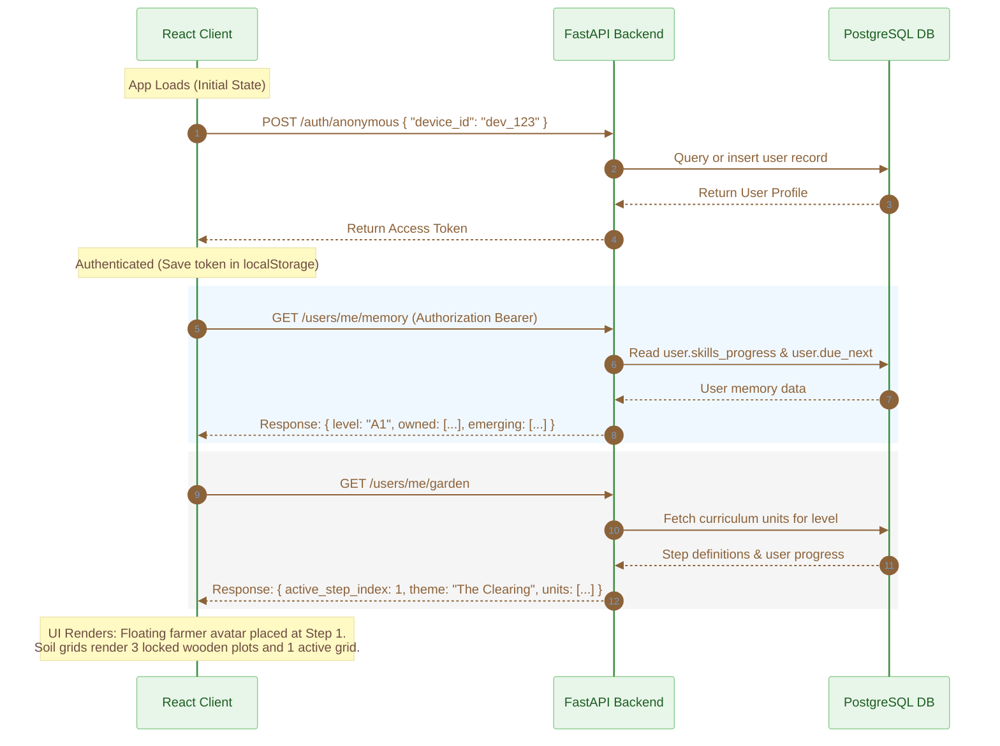
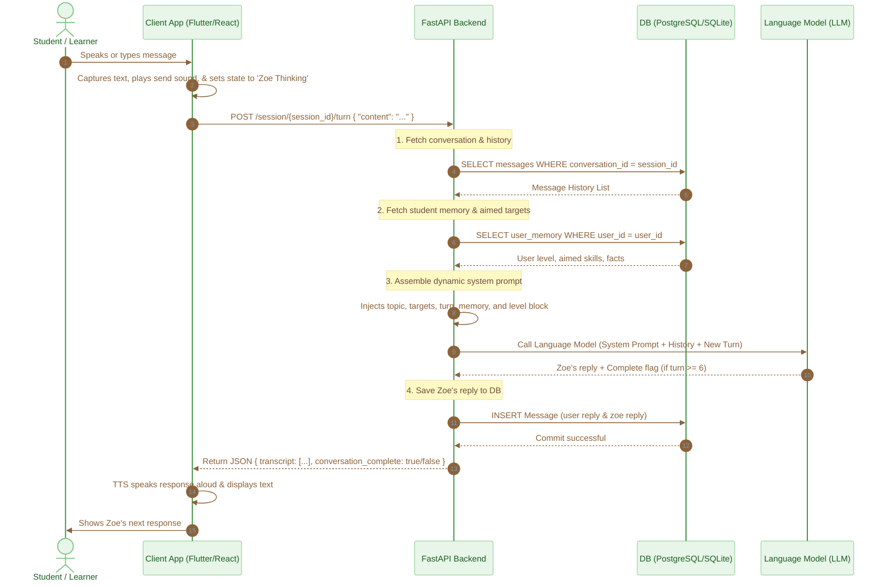
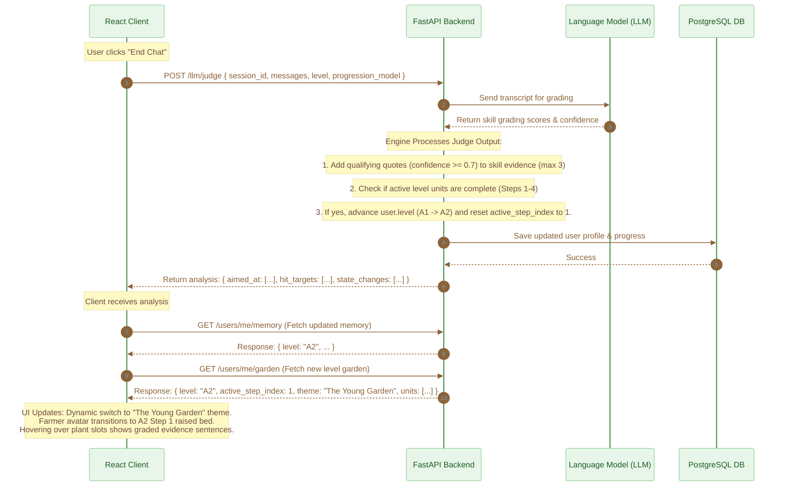

# System Architecture & Flow

This section details the API calls, data payloads, and state updates that occur as a student interacts with the ELLA application. It maps out exactly how the client maps to the backend APIs screen-by-screen.

## A. System Architecture Overview

Below is the end-to-end data flow showing how the React frontend, the FastAPI backend, the PostgreSQL Database, and the LLM Judge orchestrate user state, level transitions, and garden progress.

```mermaid
%%{init: {
  'theme': 'base',
  'themeVariables': {
    'primaryColor': '#E8F5E9',
    'primaryTextColor': '#1B5E20',
    'primaryBorderColor': '#A5D6A7',
    'lineColor': '#8C6239',
    'secondaryColor': '#F5F5F5',
    'tertiaryColor': '#FAF8F5'
  }
}}%%
graph TD
    %% Frontend Client
    subgraph Frontend [React Loop Simulator Client]
        UI[User Interface / Garden View / Chat Panel]
        State[Client State: level, activeStepNum, dbGarden, dbMemory]
    end

    %% Backend Services
    subgraph Backend [FastAPI Application Host]
        AuthRouter[/auth/anonymous]
        UsersRouter[/users/me/garden & /users/me/memory]
        SessionRouter[/session & /session/{id}/turn]
        JudgeRouter[/llm/judge]
        Engine[Progression & Curriculum Engine]
    end

    %% Database & LLM
    DB[(PostgreSQL Database)]
    LLM[Language Model / LLM Service]

    %% Flow Mappings
    UI -->|1. Request Auth/Profile| AuthRouter
    UI -->|2. Fetch Garden/Memory| UsersRouter
    UI -->|3. Start/Run Chat| SessionRouter
    UI -->|4. End Chat & Judge| JudgeRouter

    AuthRouter -->|Query/Create User| DB
    UsersRouter -->|Fetch Progress & Targets| DB
    SessionRouter -->|Fetch/Save Turns| DB
    JudgeRouter -->|Fetch Transcript| DB
    JudgeRouter -->|Grade Transcript| LLM
    JudgeRouter -->|Apply Merges & Level-up| Engine
    Engine -->|Update User Profile & Progress| DB

    DB -.->|Return JSON Data| State
    State -.->|Re-render UI| UI
```

## B. Screen-wise API Flow & State Transitions

### 1. App Launch & Initialization

When the student opens the application, the client establishes user identity, fetches user history, and builds the visual garden layout.



#### Client State Updates
* **`level`** state is updated to the user's current level (e.g. `"A1"`).
* **`dbMemory`** state is filled with the user's vocabulary and grammar checklists.
* **`dbGarden`** state is updated to populate the 4 units of the garden (sightings, plant statuses, evidence tooltips).

### 2. Active Chat Session

When the student clicks "Start Chatting", the client initiates a conversation session based on the active step's target skill. Below is the detailed sequence diagram showing the step-by-step execution flow of a single conversation turn between the client, backend, database, and the LLM service.



#### Client-Side Lifecycle (Flutter & React)
* **Capturing Input:** The client captures student speech through the Speech-To-Text (STT) engine or from the text input field.
* **Optimistic Local State Update:** The client immediately plays the send audio cue, appends the user's message to the local transcript, increments the turn count, and transitions the status to `"zoeThinking"` (displaying a loading/typing indicator).
* **API Dispatch:** The client triggers a POST request to `/session/{session_id}/turn` carrying only:
  ```json
  {
    "content": "Student speech/text transcript"
  }
  ```

#### Server-Side Lifecycle (FastAPI Backend)
* **Retrieve History:** The backend looks up all previous messages of that conversation from the database and appends the student's new reply at the end to construct the full chronological history.
* **Retrieve Student Context:** The server fetches the student's level, targeted skills (`due_next`), and facts (`persona_memory`) from the database.
* **Assemble System Prompt:** The server combines `base-prompt.md`, `level-block` (CEFR constraints), and `conv-unit-framing.md` (which contains topic details, target skills, elicitation instructions, and turn count) into a custom system prompt.
* **Run Chat Completion:** It calls the LLM API with the system prompt and the chronological message history.
* **Commit & Return:** The server stores both the user's message and Zoe's generated reply in the `messages` table, updates the conversation status to `completed = True` if the LLM signaled completion or the turn limit is reached, and returns the updated transcript to the client.

#### Client-Side Completion
* **Render Zoe:** Once the client receives the response, it extracts Zoe's reply, appends it to the local transcript, and invokes the Text-to-Speech (TTS) engine to speak it aloud.
* **Auto-End check:** If `conversation_complete` is true, the client automatically triggers the final grading (`POST /llm/judge`) workflow and moves the student to the post-conversation garden screen.

### 3. Judging, Merging, and Level-up

When the conversation terminates, the backend runs the LLM Judge to check targeted skills, save quote evidence, and progress levels.



#### Client State Updates
* **`backendAnalysis`** is populated to show the graded confidence scores inside the simulator's **Judge** panel.
* **`level`** state updates to `"A2"`, triggering the dropdown to change.
* **`dbGarden`** is updated with the newly retrieved A2 units and reset progress checks.
