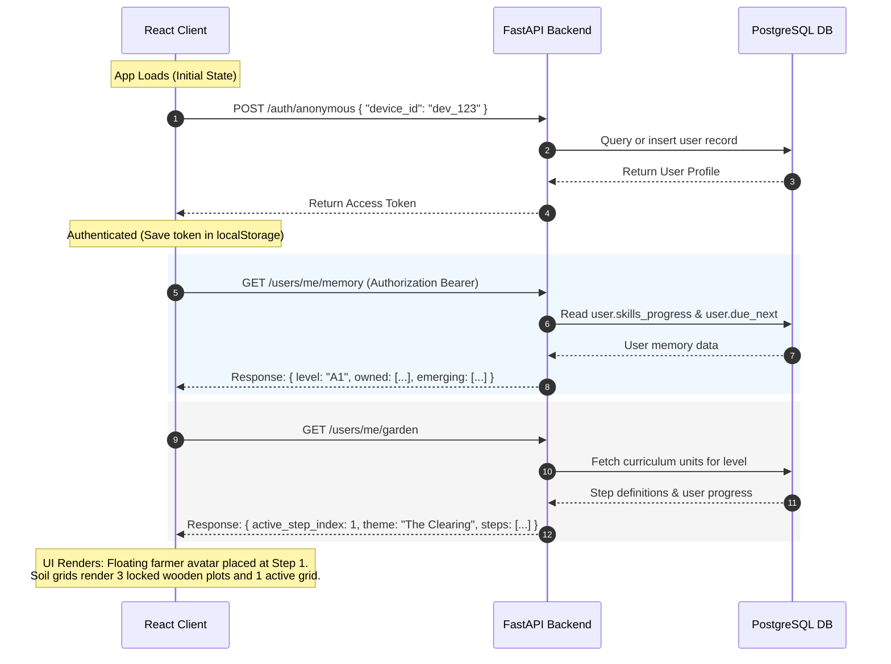
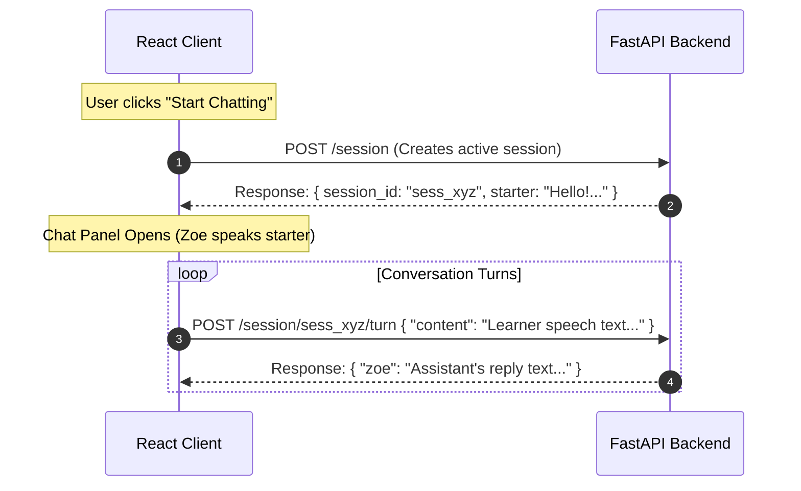
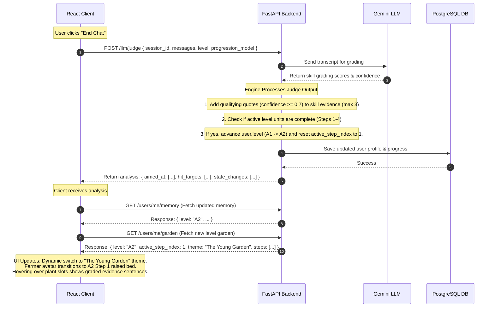

# System Architecture & Flow

This section details the API calls, data payloads, and state updates that occur as a student interacts with the ELLA application. It maps out exactly how the client maps to the backend APIs screen-by-screen.

## A. System Architecture Overview

Below is the end-to-end data flow showing how the React frontend, the FastAPI backend, the PostgreSQL Database, and the LLM Judge orchestrate user state, level transitions, and garden progress.

```mermaid
graph TD
    %% Frontend Client
    subgraph Frontend [React Loop Simulator Client]
        UI[User Interface / Garden View / Chat Panel]
        State[Client State: level, activeStepNum, dbGarden, dbMemory]
    end

    %% Backend Services
    subgraph Backend [FastAPI Application Host]
        AuthRouter[/auth/anonymous]
        UsersRouter[/users/me/garden & /users/me/memory]
        SessionRouter[/session & /session/{id}/turn]
        JudgeRouter[/llm/judge]
        Engine[Progression & Curriculum Engine]
    end

    %% Database & LLM
    DB[(PostgreSQL Database)]
    LLM[Google Gemini LLM Service]

    %% Flow Mappings
    UI -->|1. Request Auth/Profile| AuthRouter
    UI -->|2. Fetch Garden/Memory| UsersRouter
    UI -->|3. Start/Run Chat| SessionRouter
    UI -->|4. End Chat & Judge| JudgeRouter

    AuthRouter -->|Query/Create User| DB
    UsersRouter -->|Fetch Progress & Targets| DB
    SessionRouter -->|Fetch/Save Turns| DB
    JudgeRouter -->|Fetch Transcript| DB
    JudgeRouter -->|Grade Transcript| LLM
    JudgeRouter -->|Apply Merges & Level-up| Engine
    Engine -->|Update User Profile & Progress| DB

    DB -.->|Return JSON Data| State
    State -.->|Re-render UI| UI
```

## B. Screen-wise API Flow & State Transitions

### 1. App Launch & Initialization

When the student opens the application, the client establishes user identity, fetches user history, and builds the visual garden layout.



#### Client State Updates
* **`level`** state is updated to the user's current level (e.g. `"A1"`).
* **`dbMemory`** state is filled with the user's vocabulary and grammar checklists.
* **`dbGarden`** state is updated to populate the 4 steps of the garden (sightings, plant statuses, evidence tooltips).

### 2. Active Chat Session

When the student clicks "Start Chatting", the client initiates a conversation session based on the active step's target skill.



#### Client State Updates
* **`activeConvId`** is set to the generated `session_id`.
* **`msgs`** array appends messages live as chat balloons appear in the scrollable viewport.

### 3. Judging, Merging, and Level-up

When the conversation terminates, the backend runs the LLM Judge to check targeted skills, save quote evidence, and progress levels.



#### Client State Updates
* **`backendAnalysis`** is populated to show the graded confidence scores inside the simulator's **Judge** panel.
* **`level`** state updates to `"A2"`, triggering the dropdown to change.
* **`dbGarden`** is updated with the newly retrieved A2 units and reset progress checks.
