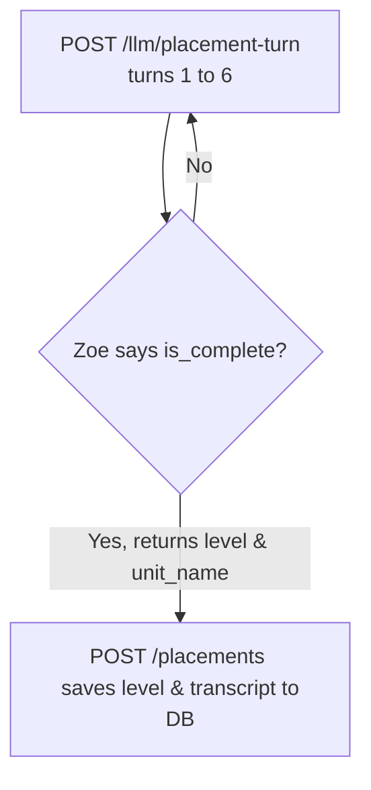

# Voice Placement System

Before starting the daily curriculum learning loop, new students take a diagnostic **Voice Placement Test** to determine their starting level.

Zoe hosts this test as an adaptive interviewer, checking their speaking level dynamically in the background.

---

## The Diagnostic Placement Loop (API sequence)

Unlike standard syllabus lessons, the placement test is **stateless** and does not create an active conversation record in the database. Instead, the message history is managed by the client and scored at the end of the test.

1. **`POST /llm/placement-turn`** (Adaptive Conversation Turn):
   - The client tracks the message history locally and sends it in the `messages` array on every turn.
   - The LLM dynamically probes the student's speaking ability, switching between easy and hard questions based on their answers.
   - When the LLM is confident about the grade, the response returns `"is_complete": true`, along with the assessed `level`, `unit_name`, and metadata.
   - **Note**: The Loop Simulator does **not** call the standard `/llm/judge` endpoint during the placement test (which prevents `404` errors since there is no database session row).

2. **`POST /placements`** (Save Assessment):
   - Once the test is complete, the client takes the resulting grading payload and posts it to the `/placements` endpoint.
   - This updates the student's `user.level` in the database and initializes their syllabus path.

---

## Detailed Payload Field Guide

When the placement test is complete, the API returns the following JSON fields:

### Key Information Fields

* **`level`** (`"A1" | "A2" | "B1" | "B2" | "C1"`): The standard CEFR level code.
* **`unit_name`** (string): The user-friendly name of the target placement unit (e.g. `"Finding My Voice"`, `"Speaking Freely"`).
* **`level_description`** (string): A short, encouraging description of the assessed level to show on the student's dashboard.

### Developmental & Diagnostic Fields

* **`age_group`** (`"10-12" | "13-15" | "16-18"`):
  Categorizes the student's age stage. Zoe uses this to adapt her vocabulary and topics (e.g., school lunches for 10-12, career goals for 16-18) to ensure the questions are developmentally appropriate.
* **`confidence`** (`"low" | "medium" | "high"`):
  How sure the LLM is of the assessment (e.g., confidence is marked `"low"` if a student gives extremely short answers).
* **`possible_higher`** (`true | false`):
  Set to `true` if the test reached the maximum turn limit (9 turns) but the student was still demonstrating strong speaking capability, indicating they might place higher with further testing.
* **`evidence_summary`** (string):
  A concise technical justification citing specific grammatical patterns or vocabulary used (e.g., *"Used simple past tense verbs correctly but struggled with complex relative clauses"*).
* **`probe_targets_covered`** (list of strings):
  Tracks which language milestones were probed (e.g. `["concrete_self", "past_narrative", "opinion_reason"]`).
* **`turns_taken`** (number):
  Total conversational turns exchanged before completing.
* **`code_switch_observed`** (boolean):
  Indicates if the child mixed Hindi and English words.
* **`interests`** (list of strings):
  Passive interests extracted from the conversation (e.g., `["cricket", "music"]`), which are automatically saved to their profile to recommend personalized syllabus units.
* **`notes_for_first_session`** (string):
  Actionable tips from Zoe for the student's first tutor session.

---

## Placement to Conversation Memory Sync

When the placement test is completed, the system updates the student's persistent **User Memory** profile so they can enter the standard conversation loop. Below is the mapping of how placement output connects to the memory fields:

### 🔗 Fields Updated by Placement
| Memory Field | Data Type | Source/Connection |
| :--- | :--- | :--- |
| **`level`** | `VARCHAR(5)` | Set to the assessed level code (e.g. `A2`). |
| **`placement`** | `JSON` | Stores the complete test metadata: `level`, `unit_label`, `confidence`, `highlight` (evidence summary text), and `created_at`. |
| **`interests`** | `VARCHAR(200)` | Automatically populated with interest tags from the conversation (e.g. `cricket, gardening`). |
| **`units` / `last_topics`** | `JSON` | Pre-set to the starting curriculum unit name (e.g. `["Finding My Voice"]`). |
| **`profile`** | `JSON` | Captures `name` and `age` from the screening initiation details. |
| **`due_next`** | `JSON` | Dynamically calculated by the curriculum manager to suggest the first lessons for the newly set level. |

### 📭 Fields Remaining Default (Curriculum-Only)
The following fields do **not** receive placement data and only begin updating once standard curriculum chats are logged:
* **`owned` / `emerging`**: Track micro-grammar/vocab milestones gained during standard lessons.
* **`sightings` / `strength`**: Count evidence instances inside standard chats.
* **`effort` (`times_spoken_total`)**: Total speaking count accumulated in daily sessions.
* **`updated_after_chat`**: Tracks standard sessions completed.

